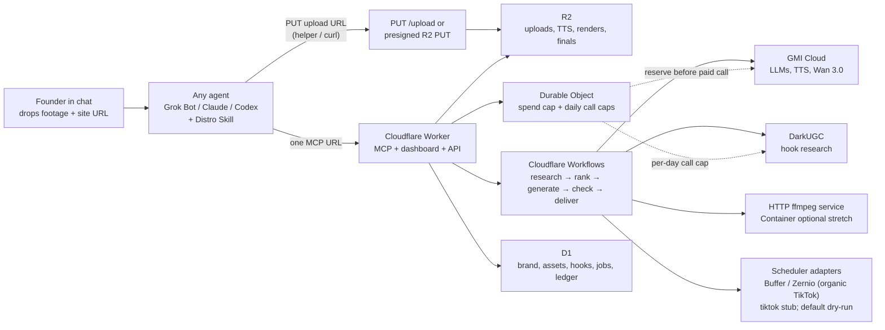

# Distro — Build Spec (hackathon handoff)

Self-contained instructions for a coding agent (Codex, Claude Code, or similar) with **no other context**. Build the system described here. **This file is a spec, not a license to start early.**

**Companion files in the same folder** (copy them into the agent's working directory):

| File | Role |
| --- | --- |
| `HACKATHON_BRIEF.md` | Event facts, sources, and the “Internal, don’t ship” note. **Read it first.** |
| `DEMO_STORY.md` | Canonical demo walkthrough (≤ 2 min, target 90–110s). Brand is a **[BRAND]** placeholder. |
| `AGENT_PROMPT.md` | Short paste-in prompt that points here. |
| `prep/one_connection_research.md` | Background research. If this file and the spec disagree, **follow the spec.** |

Do not invent a different architecture. Do not write product code or create a git repository until **18:45 local time on 2026-11-11**.

Times in this document are **local time**. In any shipped file, write “local time,” not a city or country. **Never put the city, country, venue, or any subsidiary in the repo, README, UI, comments shipped to GitHub, skill file, dashboard, captions, or demo narration.** Those names exist only in the “Internal, don’t ship” section of `HACKATHON_BRIEF.md`. Do not copy that section, or the brief itself, into the public repo. If you include this spec in the repo, do not include `HACKATHON_BRIEF.md` or anything copied from its Internal section.

---

## 0. Hard rules (read twice)

1. **Hacking window: 18:45–22:45. Judging: 22:45–23:45.** Awards after that. **No git repository, no `git init`, no commit — even an empty initial commit — before 18:45 local time on 2026-11-11.** An earlier commit makes the repo ineligible. You may read this spec and think, but you may not scaffold a repo or write product code into a git tree before that time. After 18:45, create the public repo immediately and start building.
2. **Never mention the event city, country, a venue, or a subsidiary** in the repo, README, comments that ship, UI, skill, dashboard, video captions, or demo script. (The actual names are only in `HACKATHON_BRIEF.md` → “Internal, don’t ship”; do not copy them into the repo.)
3. **Never post, publish, or send anything externally without Marx’s explicit OK.** The `publish` tool **must default to dry-run / draft**. Live posting is opt-in (`dry_run: false`) and should still be treated as off-limits during the demo unless Marx says to post.
4. **Never commit secrets, API keys, `.env`, `.dev.vars`, or wrangler secret values.** Ship `.env.example` with names only.
5. **Never commit or log raw DarkUGC content** (verbatim transcripts, captions, scripts, or downloaded videos). Store only **derived patterns** and **original lines you generate for the user’s current brand**. Do not use DarkUGC material for model training or evaluation. Prefer not to call `get_video` in v1 (it returns word-for-word transcripts).
6. **GMI keeps generating at a negative balance.** The spend cap in *our* code is mandatory. Default **`SPEND_CAP_USD=9`**. Reserve an estimate before every paid call. Refuse if the reserve would exceed the cap. Do not trust GMI’s balance figure as the limiter. Do not raise the default unless Marx says the $20 voucher landed and tells you to.
7. **TikTok AI-generated content label is required** on generated hooks / ads (burned into the video, not only a caption).
8. **The product is generic. Do not bake in a demo brand.** No product-specific briefs, hook lines, CTAs, competitor lists, ad masters, or footage in code, prompts, fixtures, or the README. Brand and context come from the user in chat (`set_brand`: a site URL and/or notes). Footage arrives as **files dropped into the agent chat**, not a required preload. Sanity checks are generic: unexpected real faces, personal photos, location cues, and claims that contradict the *current* brand profile.
9. **`publish` dry-run default, spend cap, and rate limits are not optional.** They stay even if you cut the dashboard.
10. **Self-hostable.** A stranger who clones the repo and follows the README must be able to deploy. No hidden private steps and no “ask us for a login.” Distro itself has **no sign-in** and no OAuth app registration to *use* the MCP URL. The host may complete a one-time DarkUGC OAuth so the Worker can call `https://darkugc.com/mcp` as a client; if that is not ready, generic seed patterns are the demo fallback. Do not invent a DarkUGC REST API.
11. **Workers Paid ($5/mo) is required** for Durable Objects, useful Workflow CPU (30s default, configurable to 5 min), and Containers. Workers Free Workflow steps get **10 ms of CPU** and cannot run this pipeline. Confirm the Cloudflare account is on Workers Paid in the first 15 minutes (§15).

---

## Hackathon context (summary)

Full source-cited brief, including prizes, judges, and open questions: **`HACKATHON_BRIEF.md`**. Facts below are the ones you need in order to build and submit. Do not copy the brief or its Internal section into the public repo.

| Item | Fact |
| --- | --- |
| Event | **c0mpiled-18**, YC Startup School Hackathon, Wednesday 11 November 2026 |
| Timeline (local time) | Check-in 17:30–18:00; opening 18:00; **hacking 18:45–22:45**; judging 22:45–23:45; awards 23:45. Luma notes the schedule is subject to change. |
| Submit by 22:45 | A **public GitHub repo URL** + a demo video **≤ 2 minutes** on **Loom or YouTube**. Working target **90–110s**. Canonical walkthrough: `DEMO_STORY.md`. |
| Build rule (quoted) | “Existing models, APIs, and libraries are allowed; the product itself must be built during the event.” **Any commit before 18:45, including an empty initial commit, makes the repo ineligible.** Prep (accounts, keys, assets, notes) is allowed. |
| RFS | “The $15-an-Hour Expert” (Brad Flora, YC RFS). Pitch (ours, not YC wording): every founder can now build a product in a weekend; nobody can afford a GTM expert; Distro turns a founder, or a $15-an-hour hire, into one. |
| Presentation | English |
| Venue constraints | Floor **B1**; a **Luma QR code** is required at the door; power and seating are limited; the on-site network may be unreliable. Pre-download packages, images, and a short footage subset for rehearsal; confirm API keys beforehand; have a phone hotspot ready; **pre-render** the demo video (a Wan talking-head takes on the order of 5 minutes). **Do not put the street address or city in any shipped file.** |
| GMI spend | Marx has self-funded **$10**. The hackathon **$20 voucher has not landed**. Spend cap in code: **$9** until Marx raises it. GMI keeps generating at a negative balance — our cap is mandatory. Product cost estimates use **list prices over HTTP**, not the GMI MCP (`estimate_generation` is a human/console helper only). Pin live model IDs with `GET https://api.gmi-serving.com/v1/models` after 18:45. |
| Judging rubric | A formal scored rubric was **not found**. Official sources state the build rule, English presentation, and an optional live demo to peers. Luma framing only: “get judged the way Silicon Valley judges early teams.” |
| Demo brand | **Not pre-chosen.** Marx drops footage + a site (or a brief) into the agent chat. See `DEMO_STORY.md` and §18. |

**Conflict (demo length):** the public Luma page still says “a 90-second demo video.” The official participant guide, as recorded on the plan Page, says **≤ 2 minutes** via Loom or YouTube. Follow the official-guide version: hard cap **≤ 2 min**, target **90–110s**.

## 1. Goal and pitch

**Product name:** Distro (short for distribution). Confirmation of the name is still open (see §18); use `Distro` unless Marx says otherwise.

**Tagline:** Replace your entire GTM team with one URL / plugin.

**RFS framing:** “The $15-an-Hour Expert.” Every founder can now build a product in a weekend. Nobody can afford a GTM expert. Distro turns a founder, or a $15-an-hour hire, into one.

**Story:** Founders can ship a product in a weekend. Distribution is the hard part. The meta is short-form social (TikTok). Running that takes research, creators, editors, and a team, day after day. A founder with a limited budget cannot hire that team. Distro plugs the whole content pipeline into whatever agent they already use: research viral hooks, write and rank hooks and scripts, generate talking-head hooks, cut ready-to-post 9:16 videos from footage they drop in the chat and a brand they describe (or a site URL), sanity-check the result, and hand it to whatever scheduler they already use.

**What you are building:** a **self-hostable agent plugin** in two parts that ship together:

1. **An Agent Skill** at `skills/distro/` (`SKILL.md` + small helper scripts) following the [agentskills.io specification](https://agentskills.io/specification). The skill is the playbook: conversational flow, what to ask first, how to upload dropped files, tool order, cost talk, and polling language.
2. **A remote MCP server** hosted on Cloudflare (Workers **Paid** required). The founder adds **one URL** (`https://<worker>.workers.dev/mcp`, Streamable HTTP, no auth by default) to Grok Bot, Claude, Claude Code, Codex, Cursor, ChatGPT, or any MCP client. Keys, the pipeline, uploaded footage, results, and the spend cap stay on the server.

A short read-only web dashboard is nice for the live demo and is the first thing to cut if time runs short. The same origin also serves `/health`, `/api/*`, `PUT /upload/<token>`, and a `/files/*` media proxy.

**This is not** a standalone SaaS with sign-up, OAuth, or multi-user accounts. It is a single-tenant service the founder (or a judge) can clone and deploy themselves. **This is not** a product for one specific consumer app. The user brings the brand.

**Judging deliverables:** (1) a demo video ≤ 2 minutes, target **90–110s**, canonical script in `DEMO_STORY.md`; (2) a **public GitHub repo URL**. Venue network may be flaky; **pre-render the finished product video and the walkthrough**. A talking-head Wan render takes ~5 minutes, so the live demo shows the chat-drop and tool calls and then cuts to the pre-rendered file. Record the agent chat and the (optional) dashboard **side by side** against the hosted MCP URL. Keep a pre-rendered fallback cut in R2 (`videos/demo/fallback_final.mp4`) in case the live job is not ready.

---

## 2. Hard rules

The binding list is **§0** at the top of this file. Do not weaken any of them. Short restatement: no `git init` or commit before 18:45 local time on 2026-11-11; never write the city/country/venue/subsidiary in shipped files; never post or publish externally without Marx’s explicit OK (`publish` defaults to dry-run); never commit secrets or raw DarkUGC content; GMI spend cap in *our* code (default $9); TikTok AI-generated label burned into the video; **no baked-in demo brand**; self-hostable with no Distro sign-in; Workers Paid required.

## 3. Architecture

Single-tenant Cloudflare Worker (TypeScript) on **Workers Paid**. One deployed URL serves MCP at `/mcp` (Streamable HTTP, no auth by default), a small read-only dashboard, JSON APIs at `/api/*`, `/health`, `PUT /upload/<token>`, and a `/files/*` media proxy. No OAuth on Distro itself. No multi-user account system. Optional shared bearer token, **off by default** (open hosted demo / local dev). If `DISTRO_BEARER_TOKEN` is set, require `Authorization: Bearer <token>` on MCP, API, dashboard, upload, and `/files` routes (header only; never put the token in a query string). When the env var is unset, all routes are open. **Keep the hosted demo unauthenticated:** ChatGPT does not reliably send a custom bearer, and will fail to connect if the token is set. Document this clearly in the README.

Use **`createMcpHandler` from `agents/mcp/server`**, plus `McpServer` from `@modelcontextprotocol/server` (pin the version the installed `agents` release requires; docs as of 2026-10-27 say `2.3.1`) and `zod`. Install with `npm i agents @modelcontextprotocol/server@2.3.1 zod`. **Do not start a new server on `McpAgent` — it is deprecated.** Transport: Streamable HTTP only (`createMcpHandler` does not serve SSE). Default route `/mcp` (`CreateMcpHandlerOptions.route`). Pass the *factory* (a function that returns a `McpServer`), not a constructed server. Export an object `fetch`, not the handler itself — Wrangler treats a function default export as a `WorkerEntrypoint`. Enable `nodejs_compat`. The handler is **stateless** (fresh `McpServer` per request); persist Distro state in D1 / the Durable Object / R2, not in an MCP session id. **MCP Tasks are not supported** on this stateless path — do not plan on them. CORS headers are on by default (wildcard); CORS is not authentication. Default Origin allowlist is localhost + the `workers.dev` hostname; for a custom domain set `allowedHostnames` and `allowedOriginHostnames`. Demo on `*.workers.dev` first. Optional bearer is a thin wrapper *before* the handler.

Tool names: `set_brand`, `get_brand`, `create_upload`, `analyze_footage`, `research_hooks`, `rank_hooks`, `make_video`, `get_job`, `sanity_check`, `publish`, `get_spend`. Long work returns a `job_id`; the agent polls `get_job`. Do not block a tool call for a ~5 minute Wan render.

**Chat attachments never arrive as MCP tool arguments.** They sit as files on the agent’s own machine / box. The skill instructs the agent to call `create_upload`, PUT the local file at the returned URL (helper script or curl), then call `analyze_footage` with the asset ids. Details in §5.8 and §19.



**Component roles**

| Piece | Role |
| --- | --- |
| Skill | Playbook the agent loads: ask for missing brand fields, upload dropped files, call tools in order, report cost, poll long jobs. Bundles `scripts/upload_footage.py` (default) and `scripts/prep_footage.py` (optional local ffprobe). |
| Worker | MCP tools at `/mcp`, dashboard static assets, REST for the UI, `/health`, `PUT /upload/<token>`, `/files/*` proxy, webhook/cron entry. |
| Workflows | Durable pipeline. Official limits (updated 2026-11-10): unlimited wall-clock per step, `step.sleep` up to 365 days (does not count as a step), 1 MiB max non-stream `step.do` return. Poll GMI with `step.sleep("30 seconds")` between short `step.do` status checks — do not hold a single `step.do` for five minutes of CPU. Persist video bytes in R2, never in step results. Waiting/sleeping instances do not consume concurrency. Retry failed steps. Persist `job_id` state in D1 (and/or `instance.status()`). Skip Queues at demo scale. **Requires Workers Paid** (Free = 10 ms CPU/step). |
| R2 | Uploaded footage, brand stills, TTS audio, hook clips, finals, thumbnails. Keep the bucket **private**. The Workers R2 binding **cannot mint presigned URLs** (that needs S3-style R2 API tokens). **GET** media with `GET /files/<r2_key>` (stream `env.BUCKET.get(key)`). **PUT** large chat-dropped files with a presigned S3 URL when R2 API tokens are set (see §19). Optional short-lived HMAC query so GMI can fetch `audio_url` / `first_frame` and the dashboard can play previews without making the bucket public: if `FILES_SIGNING_SECRET` is set, require `?exp=<unix_seconds>&sig=<hex>` where `sig` is HMAC-SHA256 of the UTF-8 string `${exp}.${r2_key}` using that secret, default TTL 15 minutes. If the secret is unset, `/files` is open on an unauthenticated demo Worker — document the risk. A `workers.dev` `/files` URL is a publicly reachable HTTP URL, which GMI requires. Do not rely on `r2.dev` (rate-limited, dev only). Decode and normalize the key path (no `..`). |
| D1 | Brand profile, hooks, ranks, jobs, sanity results, derived patterns, spend ledger copy, publish drafts, asset index, pending uploads. Integer cents. Do not put raw media in D1. |
| Durable Object `GuardrailsDO` | **One named instance** (`getByName("global")` / `idFromName("global")`) for the process-wide spend cap and the DarkUGC daily call counter. This is an intentional single-tenant exception to “don’t use a global DO.” Use SQLite (`new_sqlite_classes`), RPC methods (`reserve` / `commit` / `release` / `consumeDarkUgc` / `getState`), and write storage before returning. Reserve/commit must be serialized so parallel renders cannot overshoot. **Requires Workers Paid.** D1 `spend_ledger` is an audit copy, not the source of truth. |
| Secrets | Wrangler secrets in prod; `.dev.vars` / `.env` locally (gitignored). |
| ffmpeg | **Default editor: a small HTTP service** (`POST /edit` at `FFMPEG_SERVICE_URL`). Full contract in **§20**. The deployed Worker **cannot** call `localhost`; the service needs a public HTTPS URL (typically a `cloudflared` quick tunnel). Script-timed captions if ASR is late (acceptable for v1; do not block the finished video on WhisperX). The user’s agent may have ffmpeg, but that is **not guaranteed** (Grok Bot / cloud agents often have no durable ffmpeg). Use local ffmpeg only for optional pre-upload probe/thumbnails, or as an emergency fallback if the service is down. **Optional stretch:** a slim Cloudflare Container with ffmpeg + ffprobe only, and only if Workers Paid and Docker both work in the first 15 minutes. **Do not** put WhisperX in the v1 image. **Do not** use Cloudflare Stream / Media Transformations as the editor — they can trim/crop/mute a single clip or emit a frame, but cannot concat hook+body, burn captions, mux TTS, or overlay an AI label. Skip the Sandbox SDK. |
| Cron | Optional daily research trigger. Cut if short on time. |

**Auth model (final):** none by default. Optional shared bearer, off unless `DISTRO_BEARER_TOKEN` is set. No OAuth, no CIMD, no DCR, no per-user tables, no sign-in UI. Hosted demo stays open because ChatGPT (“No authentication” only) will not reliably send a custom bearer.

**How clients add the one URL** (all of these accept an unauthenticated Streamable HTTP `/mcp` URL; **verify** the exact CLI / JSON if a client’s help text differs):

- Claude (Customize → Connectors → Add → Custom → Web, choose “No sign in”).
- Claude Code: `claude mcp add --transport http distro https://<worker>.workers.dev/mcp`, and/or project `.mcp.json` with `"type": "http"` and `"url"` (a URL-only entry without `type` may be treated as stdio and skipped — **verify**). A Claude Code plugin is `.claude-plugin/plugin.json` plus root `.mcp.json`; see §4.
- Cursor: `.cursor/mcp.json` or `~/.cursor/mcp.json`: `{ "mcpServers": { "distro": { "url": "https://…" } } }` (**verify** whether `type` is required).
- ChatGPT: custom MCP, “No authentication” + risk warning — do not enable bearer.
- Codex: `codex mcp add distro --url https://…` or `~/.codex/config.toml` under `[mcp_servers.distro]` with `url = "https://…"` (**verify**). Skills: prefer `.agents/skills/distro` and/or `~/.agents/skills/distro` (some docs also mention `~/.codex/skills/` — **verify** current paths). Point `AGENTS.md` at the skill and the MCP server.
- Grok Bot: ask in chat: `Add this MCP server: https://<worker>.workers.dev/mcp`. Then install or paste `skills/distro/SKILL.md` (or, after the build, pack a shareable Grok Bot template — that packaging step is Marx’s Grok Bot, not this coding agent). Localhost / stdio / VPN hosts fail because the connection is made from the provider’s infra, not the user’s laptop.

Mid-build smoke test: Workers AI Playground or MCP Inspector. Do not depend on an internal `AddMcpServer` tool in the public README.

---

## 4. Repo layout (plugin + server)

Suggested public repo name: `distro`. Adjust if the name is taken. All paths below are relative to the repo root. This layout follows the Agent Skills standard (`skills/<name>/SKILL.md`) and the Claude Code plugin default locations (`skills/`, `.mcp.json`, `.claude-plugin/plugin.json`). Exact client config keys are marked **verify** where the docs can drift.

```
distro/
  README.md                 # self-host + plugin install; no city/country/subsidiary; no baked-in brand
  LICENSE                   # MIT unless Marx says otherwise
  AGENTS.md                 # short: use the Distro skill, connect the MCP URL, never commit secrets
  .gitignore                # .env, .dev.vars, node_modules, .wrangler, raw media
  .env.example              # names only, every secret and tunable
  .mcp.json                 # example remote MCP config (placeholder URL)
  .claude-plugin/
    plugin.json             # Claude Code plugin manifest
    marketplace.json        # optional: repo-as-marketplace, plugins[0].source = "./"
  package.json
  tsconfig.json
  wrangler.jsonc
  skills/
    distro/
      SKILL.md              # agentskills.io: name: distro (must match folder)
      scripts/
        upload_footage.py   # default helper: PUT dropped files to create_upload URL, JSON out
        prep_footage.py     # fallback: local ffprobe + optional thumbs if the agent has a shell
      references/
        flow.md             # optional: longer intent routing, cut if the skill body stays short
  src/
    index.ts                # fetch router: /mcp, /health, /upload/:token, /files/*, dashboard, /api/*
    models.ts               # pinned GMI model IDs after GET /v1/models (§15)
    mcp/tools.ts            # tool registrations + JSON schemas
    mcp/auth.ts             # optional bearer check; no-op when token unset
    files/proxy.ts          # GET /files/<r2_key> streams R2; optional short-lived HMAC
    files/upload.ts         # create_upload tokens, PUT /upload, optional presign
    pipeline/workflow.ts
    pipeline/research.ts
    pipeline/rank.ts
    pipeline/generate.ts    # TTS + Wan
    pipeline/edit.ts        # calls HTTP ffmpeg service
    pipeline/sanity.ts
    pipeline/publish.ts
    pipeline/brand.ts       # set/get brand, site fetch
    adapters/gmi.ts
    adapters/darkugc.ts     # MCP client of https://darkugc.com/mcp; methods match §9
    adapters/schedulers/types.ts
    adapters/schedulers/dryrun.ts
    adapters/schedulers/buffer.ts
    adapters/schedulers/zernio.ts
    adapters/schedulers/tiktok.ts  # stub: Ads API ≠ organic posting
    guardrails/GuardrailsDO.ts
    db/schema.sql
    db/client.ts
    ui/                     # minimal dashboard (static)
  migrations/
    0001_init.sql           # D1 schema (same contents as src/db/schema.sql)
  container/                # optional stretch only
    Dockerfile              # slim ffmpeg + ffprobe, NO WhisperX
    server.ts               # HTTP API, same POST /edit contract as §20
  prompts/                  # hook-gen, G-Eval, pairwise, sanity — generic, take brand from D1
  fixtures/
    hook-patterns-seed.json # derived GENERIC pattern types only, no brand-specific lines
  scripts/
    ffmpeg-service.mjs      # local HTTP POST /edit server (§20)
    darkugc-oauth.ts        # one-time OAuth vs https://darkugc.com/mcp; tokens go in secrets, not git
    upload-assets.sh        # optional self-host bulk path, not the demo path
```

Suggested `wrangler.jsonc` shape (fill IDs after `wrangler` create commands; do not invent production IDs in git):

```jsonc
{
  "name": "distro",
  "main": "src/index.ts",
  "compatibility_date": "2026-11-11",
  "compatibility_flags": ["nodejs_compat"],
  "durable_objects": {
    "bindings": [{ "name": "GUARDRAILS", "class_name": "GuardrailsDO" }]
  },
  "migrations": [{ "tag": "v1", "new_sqlite_classes": ["GuardrailsDO"] }],
  "workflows": [
    { "name": "make-video", "binding": "MAKE_VIDEO", "class_name": "MakeVideoWorkflow" }
  ],
  "d1_databases": [{ "binding": "DB", "database_name": "distro", "database_id": "<id>" }],
  "r2_buckets": [{ "binding": "BUCKET", "bucket_name": "distro" }]
  // optional stretch: "containers": [{ "class_name": "FfmpegContainer", "image": "./container/Dockerfile" }]
}
```

Example `.mcp.json` (Claude Code / some MCP clients; **verify** `type` if a client rejects it). Replace the URL after deploy, or use a `userConfig` substitution in the Claude plugin (see below):

```json
{
  "mcpServers": {
    "distro": {
      "type": "http",
      "url": "https://<worker>.workers.dev/mcp"
    }
  }
}
```

Example `.claude-plugin/plugin.json` (Claude Code; `name` is required, kebab-case; `author.name` is required if `author` is present; **verify** with `claude plugin validate ./` when the CLI is available):

```json
{
  "name": "distro",
  "displayName": "Distro",
  "version": "0.1.0",
  "description": "Replace your GTM team: research hooks, make short-form videos from footage you drop in chat, sanity-check them, and hand them to your scheduler.",
  "author": { "name": "Distro" },
  "license": "MIT",
  "keywords": ["gtm", "tiktok", "ugc", "mcp"],
  "userConfig": {
    "mcp_url": {
      "type": "string",
      "title": "Distro MCP URL",
      "description": "Your Distro Worker URL ending in /mcp, e.g. https://distro.<account>.workers.dev/mcp",
      "required": true
    }
  }
}
```

If Claude Code substitutes `${user_config.mcp_url}` into plugin MCP configs (**verify**), `.mcp.json` may use `"url": "${user_config.mcp_url}"` so one install prompts for the hosted or self-hosted URL. If that substitution is not supported for HTTP servers, document pasting the URL into `.mcp.json` instead.

Optional `.claude-plugin/marketplace.json` so the GitHub repo can be added as a marketplace (`source: "./"`, same `name` as `plugin.json`). Cut this file if time is short; `plugin.json` + `skills/` is enough.

Do **not** commit footage, ad masters, or anything from a local rehearsal folder. Fixtures are generic JSON only (pattern types, not brand lines).

---

## 5. MCP tool contracts

Tool names: 1–128 chars, `[A-Za-z0-9_.-]`. Return small structured JSON (ids, paths/URLs, scores, short reasons). Never return video bytes. Errors: `isError: true` with an actionable message (e.g. “Would exceed spend cap: est $0.50 > remaining $0.12; use duration_s=4 or resolution=480P”). No stack traces. Deterministic tool order in `tools/list`.

Idempotency: `make_video` (and paid GMI calls) derive a key from `(hook_id, footage_keys, model, params)`. If a successful or in-flight job exists, return that `job_id` instead of spending again. `create_upload` for the same `(filename, size_bytes, sha256)` may reuse a still-valid pending token.

**MCP tools cannot receive chat attachments.** Never invent a `files` argument that claims to carry bytes. The pattern is §5.8–5.9.

If `get_brand` returns `set: false` and the user asked to research or make videos, the skill must call `set_brand` (or ask the user) before `research_hooks` / `rank_hooks` / `make_video`. Those tools refuse with a clear error if no brand profile and no `brief` override is present.

### 5.1 `research_hooks`

Search DarkUGC for what is working now, distill **patterns**, and optionally draft fresh hook lines for the **current brand**. Counts against the DarkUGC daily call cap. If the Worker’s DarkUGC MCP client cannot authenticate, still return useful output from `fixtures/hook-patterns-seed.json` (generic pattern types only), set `notes` to say so, and keep `calls_used` honest (zero live calls).

**Input**

```json
{
  "type": "object",
  "additionalProperties": false,
  "properties": {
    "brief": { "type": "string", "description": "Optional product brief override. If omitted, use the stored brand profile from set_brand." },
    "platform": { "type": "string", "enum": ["TikTok", "Instagram"], "default": "TikTok" },
    "posted_within_days": { "type": "integer", "minimum": 7, "maximum": 90, "default": 45 },
    "max_calls": { "type": "integer", "minimum": 1, "maximum": 30, "default": 12, "description": "Hard-capped by remaining daily DarkUGC budget." },
    "competitor_brands": {
      "type": "array",
      "items": { "type": "string" },
      "description": "Optional. Defaults to brand_config.competitors_json if set. Ignore follower-spy / dating-spy brands unless the user’s brand is actually in that category."
    }
  }
}
```

**Output**

```json
{
  "research_id": "rsh_...",
  "patterns": [
    {
      "pattern_id": "pat_...",
      "hook_type": "bold claim",
      "format_family": "talking head then screen",
      "why": "short original paraphrase, no verbatim source lines",
      "brand_angle": "how this maps to the current brand without overclaiming",
      "evidence": { "view_band": "high", "recency": "last_45d", "n_examples": 3 }
    }
  ],
  "seed_hooks": [
    { "text": "original line for the current brand", "pattern_id": "pat_...", "footage_hints": ["ast_..."] }
  ],
  "calls_used": 8,
  "calls_remaining_today": 22,
  "notes": "Dating-spy hooks in a generic social category were ignored."
}
```

### 5.2 `rank_hooks`

Generate (~20 by default), dedupe, and rank hooks and short scripts (Hook / Body / CTA) for the current brand. Uses GMI LLMs only (no DarkUGC calls required). May take a `research_id`.

**Input**

```json
{
  "type": "object",
  "additionalProperties": false,
  "properties": {
    "research_id": { "type": "string" },
    "brief": { "type": "string" },
    "n": { "type": "integer", "minimum": 5, "maximum": 40, "default": 20 },
    "seed_hooks": { "type": "array", "items": { "type": "string" } }
  }
}
```

**Output**

```json
{
  "run_id": "rnk_...",
  "hooks": [
    {
      "hook_id": "hk_...",
      "rank": 1,
      "hook": "...",
      "body": "...",
      "cta": "from brand_config.cta, or a short generic download/visit line if unset",
      "pattern_id": "pat_...",
      "footage_hints": ["ast_..."],
      "want_talking_head": true,
      "scores": { "pointwise_avg": 4.2, "elo": 1210 },
      "reasons": ["..."]
    }
  ],
  "discarded": { "rule_filter": 4, "near_dupes": 6 },
  "cost_usd": 0.04
}
```

Return the top 5 in full plus a compact leaderboard for the rest (hook line + rank + elo only) to keep tokens down.

### 5.3 `make_video`

Start the generate → edit → sanity pipeline. **Always returns immediately with a `job_id`.** Never blocks on Wan.

**Input**

```json
{
  "type": "object",
  "additionalProperties": false,
  "required": ["hook_id"],
  "properties": {
    "hook_id": { "type": "string" },
    "footage_keys": { "type": "array", "items": { "type": "string" }, "description": "R2 object keys or asset ids. If omitted, pick from hook.footage_hints and recent analyze_footage results, skipping banned / private-flagged assets." },
    "body_asset": { "type": "string", "description": "asset id or r2_key, or auto" },
    "resolution": { "type": "string", "enum": ["480P", "720P"], "default": "480P" },
    "hook_duration_s": { "type": "integer", "minimum": 3, "maximum": 8, "default": 5 },
    "confirm_usd": { "type": "number", "description": "Required when the estimate is >= $0.50. Client must echo the estimate." }
  }
}
```

**Output**

```json
{
  "job_id": "job_...",
  "status": "queued",
  "estimated_usd": 0.42,
  "reserved_usd": 0.42,
  "poll": "get_job"
}
```

Refuse with a clear error if: spend cap would be exceeded; `confirm_usd` required and missing/mismatched; hook_id unknown; all requested footage is missing or flagged private; no brand profile and no brief.

### 5.4 `get_job`

**Input:** `{ "job_id": "string" }` (required).

**Output:**

```json
{
  "job_id": "job_...",
  "status": "queued|running|waiting_render|editing|checking|ready|failed|discarded",
  "step": "tts|wan|edit|sanity",
  "estimated_usd": 0.42,
  "actual_usd": 0.41,
  "hook_id": "hk_...",
  "preview_url": "https://<worker>.workers.dev/files/videos/job_.../final.mp4",
  "final_r2_key": "videos/job_.../final.mp4",
  "sanity": { "passed": true, "items": [], "actions": [] },
  "error": null
}
```

`preview_url` is a Worker `/files` proxy URL (optional short-lived HMAC query `exp` + `sig`). Do not emit R2 “presigned” GET URLs from the Workers binding — it cannot mint them.

### 5.5 `sanity_check`

Re-run or inspect checks on a finished (or almost finished) job. See §11.

**Input:** `{ "job_id": "string" }` or `{ "r2_key": "string", "hook_id": "string" }`.

**Output:** the checklist object in §11 (pass/fail per item, auto-fix actions, final verdict `pass` | `fixed` | `discard`).

### 5.6 `publish`

Hand a ready video to a scheduler adapter. **`dry_run` defaults to `true`.** A dry run writes a `publish_drafts` row and returns the payload that *would* have been sent. It must not call a third-party post endpoint.

**Input**

```json
{
  "type": "object",
  "additionalProperties": false,
  "required": ["job_id"],
  "properties": {
    "job_id": { "type": "string" },
    "adapter": { "type": "string", "enum": ["dryrun", "buffer", "zernio", "tiktok"], "default": "dryrun", "description": "tiktok is a stub (Ads API, not organic). Use buffer or zernio for organic TikTok." },
    "dry_run": { "type": "boolean", "default": true },
    "caption": { "type": "string" },
    "schedule_at": { "type": "string", "description": "ISO-8601. Optional. Ignored unless dry_run is false and the adapter supports it." }
  }
}
```

**Output**

```json
{
  "draft_id": "pub_...",
  "job_id": "job_...",
  "adapter": "dryrun",
  "dry_run": true,
  "accepted": true,
  "external_id": null,
  "payload": { "note": "exactly what would be / was sent, minus secrets" },
  "message": "Dry-run only; nothing was posted."
}
```

If `dry_run` is false and Marx has not approved live posting, still allow the code path for self-hosters, but the demo skill and README must say to leave it true. Refuse to publish a job whose sanity verdict is `discard`.

### 5.7 `get_spend`

**Input:** `{ "days": { "type": "integer", "minimum": 1, "maximum": 30, "default": 1 } }` optional.

**Output:**

```json
{
  "cap_usd": 9.0,
  "spent_usd": 1.22,
  "reserved_usd": 0.40,
  "remaining_usd": 7.38,
  "max_render_usd": 1.0,
  "darkugc_calls_today": 8,
  "darkugc_daily_cap": 30,
  "entries": [{ "at": "ISO-8601", "kind": "reserve|commit|release", "usd": 0.4, "job_id": "job_...", "model": "wan3.0-video", "note": "8s 480P" }]
}
```

Money is USD. Quote dollars, not micro-units.

### 5.8 `create_upload`

Mint a short-lived upload slot for a file that already exists on the **agent’s machine** (a chat attachment). Returns a URL the agent PUTs with the skill helper or curl. Does not accept file bytes.

**Input**

```json
{
  "type": "object",
  "additionalProperties": false,
  "required": ["filename", "size_bytes", "content_type"],
  "properties": {
    "filename": { "type": "string", "description": "Original filename, used only for extension and display." },
    "size_bytes": { "type": "integer", "minimum": 1 },
    "content_type": { "type": "string" },
    "sha256": { "type": "string", "description": "Optional hex digest for reuse of a pending slot." }
  }
}
```

Refuse if `content_type` / extension is not in the allowlist, or if `size_bytes` exceeds the mode’s max (see below). Allowlist: `video/mp4`, `video/quicktime`, `video/webm`, `video/x-m4v`, `image/jpeg`, `image/png`, `image/webp` (and the obvious filename extensions `.mp4`, `.mov`, `.webm`, `.m4v`, `.jpg`, `.jpeg`, `.png`, `.webp`).

**Output**

```json
{
  "asset_id": "ast_...",
  "r2_key": "uploads/<uuid>/<safe_filename>",
  "upload_url": "https://...",
  "method": "PUT",
  "headers": { "Content-Type": "video/mp4" },
  "mode": "presigned",
  "max_bytes": 536870912,
  "expires_at": "ISO-8601",
  "complete": "After a 2xx PUT, call analyze_footage with this asset_id."
}
```

**Mode selection (default for the demo: prefer presigned when keys exist)**

1. **Presigned S3 PUT (preferred when configured).** If `R2_ACCESS_KEY_ID`, `R2_SECRET_ACCESS_KEY`, and `CLOUDFLARE_ACCOUNT_ID` are set, sign a PUT to `https://<ACCOUNT_ID>.r2.cloudflarestorage.com/<bucket>/<key>` with `aws4fetch` (or the AWS SDK). The Workers R2 **binding cannot** mint this URL. TTL default 15 minutes. App-level max: **512 MB** per file (enough for a live drop; R2 single-part max is 5 GiB, which we do not need). Restrict `Content-Type` in the signature when the library supports it. After the client PUTs, it **must** call `analyze_footage` (R2 will not notify the Worker).
2. **Worker `PUT /upload/<token>` (fallback, no extra keys).** The Worker streams `request.body` into `env.BUCKET.put` — **never** `arrayBuffer()` / `text()` the whole file (isolate memory is **128 MB**). Advertise a conservative max of **80 MB**. Cloudflare request-body limits are **zone-plan** based, not Workers-plan based: Free/Pro **100 MB**, Business **200 MB**, Enterprise up to **5 GB** ([Workers limits](https://developers.cloudflare.com/workers/platform/limits/), updated 2026-10-29). For `*.workers.dev`, treat **100 MB** as the working assumption and **verify** with a large PUT in §15 — the docs key the limit off the domain’s plan. A 90 MB iPhone recording is close to that ceiling, which is why presign is preferred for the hosted demo. The PUT handler writes the object, marks the upload complete, and can run a cheap HEAD; `analyze_footage` still does the probe.

`CLOUDFLARE_ACCOUNT_ID` is already needed for wrangler; listing it in `.env.example` for presign is fine. CORS on the R2 bucket is only required if a **browser** PUTs; a skill script / curl from the agent machine does not need bucket CORS.

Reject oversize Content-Length, wrong content-type, expired or reused tokens, and path traversal in keys. Tokens are `crypto.randomUUID()` (or equivalent), single-use, stored in D1 `uploads`.

### 5.9 `analyze_footage`

Confirm one or more uploads landed, probe them, store metadata, and return asset ids the later tools can use. This is also the “complete upload” step for the presigned path.

**Input**

```json
{
  "type": "object",
  "additionalProperties": false,
  "required": ["asset_ids"],
  "properties": {
    "asset_ids": { "type": "array", "items": { "type": "string" }, "minItems": 1 },
    "notes": { "type": "string", "description": "Optional user description of the batch." }
  }
}
```

**Output**

```json
{
  "assets": [
    {
      "asset_id": "ast_...",
      "r2_key": "uploads/…/clip.mp4",
      "status": "ready",
      "kind": "footage",
      "filename": "clip.mp4",
      "duration_ms": 12000,
      "width": 1206,
      "height": 2622,
      "has_audio": false,
      "banned": false,
      "warnings": ["not_9_16", "silent_or_very_quiet"],
      "thumb_r2_key": "uploads/…/clip.jpg"
    }
  ],
  "notes": "3 ready, 1 missing (upload never completed)"
}
```

Probe with the HTTP ffmpeg service (`ffprobe` / a `POST /probe` if you add one; otherwise a tiny probe endpoint on the same service as §20) when possible. If the service is down, store the object with `probe_pending` and still return the asset id. Optional skill script `prep_footage.py` may send width/height/duration/has_audio it already measured; trust-but-verify when the service is up.

Flag, do not silently use, frames that look like unexpected real faces, personal photos, or location cues (`warnings` + `banned=1` only when confidence is high, or when the user asks to exclude them). The user can override a false flag later; the demo skill should mention warnings in chat.

### 5.10 `set_brand`

Create or replace the single-tenant brand profile. Used by hook generation and the `off_brand` sanity check.

**Input**

```json
{
  "type": "object",
  "additionalProperties": false,
  "properties": {
    "name": { "type": "string" },
    "site_url": { "type": "string", "description": "Official site or store URL to scrape." },
    "notes": { "type": "string", "description": "User-supplied brief, positioning, and anything the site misses." },
    "niche": { "type": "string" },
    "audience": { "type": "string" },
    "tone": { "type": "string" },
    "platform": { "type": "string", "enum": ["TikTok", "Instagram"] },
    "cta": { "type": "string" },
    "competitors": { "type": "array", "items": { "type": "string" } },
    "avoid_claims": { "type": "array", "items": { "type": "string" } }
  }
}
```

At least one of `name`, `site_url`, or `notes` is required. If `site_url` is present, the Worker **fetches** it (timeout ~8s, cap response size, follow a small number of redirects, strip to visible text / title / description / og tags). Do not require Firecrawl. If the fetch fails (JS-only site, block, timeout), keep the user notes, set `scrape_ok: false`, and say so. Persist in D1 `brand_config` (single row). Do not invent features the site or the user did not state.

**Output:** the same object as `get_brand`, plus `scrape_ok` and a short `site_excerpt`.

### 5.11 `get_brand`

**Input:** empty object.

**Output:** `{ "set": false }` if no row, otherwise:

```json
{
  "set": true,
  "name": "...",
  "site_url": "https://...",
  "site_excerpt": "truncated text",
  "scrape_ok": true,
  "notes": "...",
  "niche": "...",
  "audience": "...",
  "tone": "...",
  "platform": "TikTok",
  "cta": "...",
  "competitors": [],
  "avoid_claims": [],
  "updated_at": "ISO-8601"
}
```

---

## 6. Pipeline steps, prompts, and rubrics

Workflow name: `MakeVideoWorkflow` (plus a lighter `ResearchRankWorkflow` if you want research+rank durable; those steps are fast enough to run in the tool handler with a waitUntil if needed). `make_video` does `env.MAKE_VIDEO.create({ id: jobId, params })` and returns `{ job_id, status: "queued", poll: "get_job" }` immediately. `get_job` reads D1 (updated by the workflow) or `instance.status()`.

Suggested step breakdown (keep each `step.do` short; persist R2 keys, not bytes; max non-stream return is 1 MiB): `reserve` → `tts` (submit + poll, copy to R2, return the key) → `wan-submit` (return `request_id`) → loop up to ~12 min: `step.sleep("30 seconds")` then a short `wan-poll` `step.do` → `edit` (`POST $FFMPEG_SERVICE_URL/edit`, write final to R2) → `sanity` → `commit` or `release`. On `failed` / `cancelled`, release the reserve. Treat a `dispatched` status as in-progress if it appears.

**Default end-to-end video shape:** 3–6s talking-head or text hook + a body cut from the user’s uploaded footage + CTA card using the brand CTA if set. Total ~18–25s when the body allows, 1080×1920 9:16, captions, audio, AI label. If the user only uploaded a short clip, ship a shorter honest cut rather than looping padding.

### 6.1 Research (DarkUGC → patterns)

Adapter methods and exact argument names are in §9. Recommended v1 call sequence (stay under `max_calls` and the daily cap; 8–12 is enough):

1. `get_search_filters` — once, cache in D1 for the day (optional; skip if budget is tight).
2. `trending_now` `{ days: 7, platform: "TikTok" }` and/or with `brand_category` from the brand profile if it fits. The generic `social` category is often dominated by follower-spy and dating apps; **ignore those hook styles unless they match the user’s actual brand.**
3. `query_library` on `competitor_brands` if the user or `set_brand` provided any, `posted_within_days` 45 or 180, `group_by: "hook_type"` and/or `format_family`. If no competitors, search by niche / category / query from the brand profile.
4. `top_hooks` on the same set, `sort: "views"`, maybe a second page or a `hook_type` filter (`pov`, `bold claim`, `problem`, `curiosity gap`).
5. Optional: `analyze_niche` or `analyze_brand` for one close comp or the user’s own name.
6. Do **not** call `get_video` in v1. Do **not** paginate deeply. Do **not** call `creator_campaigns` unless a later “find creators” path is added (nice-to-have, cut first with the dashboard).

Pass the structured summaries (rounded views, hook types, format families, brand names, darkugc.com links if present) into a GMI LLM and ask it to emit **original paraphrased patterns** and **original lines for the current brand**. Persist only that derived JSON.

**Seed fallback** (`fixtures/hook-patterns-seed.json`): generic pattern *types* only, for example: counterintuitive hot take; missing-someone / they’re already here; dead chat replaced; years and just found this; daily ritual + widget or streak; “the thing we actually do on the call”; how-to for a friend group; problem → product as the punchline. **Do not** store example lines for a specific app. When this fallback is used, `research_hooks` still drafts original lines from the brand profile, and `notes` must say seed patterns were used.

### 6.2 Strategy and mass generation

For a 4-hour hack, do **not** generate 450 scripts. Generate about **20 hooks** (optionally 20 short Hook/Body/CTA scripts). If time allows, use verbalized sampling (ask the model to propose several distinct candidates in one call) with two cheap models and merge.

**Script model candidates** (IDs unconfirmed — pin from `GET /v1/models` at 18:45): planned `DeepSeek-V4.1-Flash-1017` / docs also show `deepseek-ai/DeepSeek-V4-Flash`; planned `GLM-5.3 Flash` / docs also show `zai-org/GLM-5.1-FP8`. Use whatever official IDs exist on the live list. Temperature moderate; require JSON out.

**System constraints for generation** (inject the stored brand profile):

- Brand bible = `get_brand` (name, excerpt, notes, audience, tone, CTA, avoid_claims). Do not invent claims the profile does not support.
- No medical, relationship-saving, or “always watching you” / surveillance claims unless the user’s own brand is clearly in that category and they opted in — default is to refuse those styles.
- No invented biographies presented as fact.
- No city/country/subsidiary.
- CTA from `brand_config.cta` when set.
- AI-generated hooks will be labeled; do not pretend the face is a real customer.
- Do not use private-flagged assets in `footage_hints`.

### 6.3 Dedupe

Cheap pass: normalize whitespace/case, drop exact dups, then embedding cosine **> 0.9** drops (GMI embedding if available; otherwise a second LLM “are these the same hook? yes/no” pairwise on close lexical matches, or skip embeddings and use MinHash / normalized lexical overlap). Keep diversity of hook types.

### 6.4 Pointwise rubric (G-Eval style)

Use a **different model family** from the generator as judge when possible. Candidates: planned `Qwen3.8 27B`, `MiniMax-M3` — again, pin live IDs. Fallback: `Qwen/Qwen3.5-35B-A3B` (documented).

Instruction: reason first, then score 1–5 on each criterion. Shuffle criterion order per call to reduce position bias. Average two judges if budget allows; one judge is acceptable at hackathon speed.

**Criteria (1–5):**

1. **Hook strength** — would a stranger keep watching past 3s?
2. **Brand fit** — true to the current brand profile, no overclaim.
3. **Specificity** — concrete ritual or image, not generic “best app ever.”
4. **Footage fit** — can be proven with available (non-flagged) uploaded clips.
5. **Platform fit** — spoken + on-screen text would work as UGC, not a TV ad.
6. **Safety** — no banned claim classes, no private-content hints.

Keep hooks with average ≥ 3.5 or the top 8–10, whichever is smaller. Then take up to 8 into the pairwise stage (8 is enough; 32 is too slow tonight).

### 6.5 Pairwise tournament

For each pair, judge **A vs B and B vs A** (swap order — MT-Bench position bias). Same judge model. Update Elo (start 1000, K=32) or Bradley-Terry. Output top 5 with short reasons.

### 6.6 Talking-head + TTS + edit

1. **Estimate** the Wan + TTS cost. **Reserve** on the Durable Object. Require `confirm_usd` when estimate ≥ $0.50.
2. **TTS:** model id `minimax-tts-speech-2.8-turbo` via GMI request queue. Voice default `English_expressive_narrator`. Format `mp3`. Poll to `outcome.media_urls[0].url`. Save to R2.
3. **Wan talking-head:** model `wan3.0-video`. Payload must use **uppercase** resolution (`480P` / `720P` — lowercase is rejected and refunded in ~1s). Default demo: `480P`, `ratio: "9:16"` (do not rely on default `adaptive` for text-only, which behaves like 16:9), `duration` 5 (2–30 allowed; 8s 480P list price = **$0.40**; 720P = **$0.80**; 1080P = $0.20/s — do not use 1080P tonight). `prompt` describes a casual UGC selfie saying the hook (no brand logo tattoos, no readable fake UI). **`audio_url` is a documented optional Wan 3.0 parameter** (“Audio used to drive the generated video”, wav/mp3) but is **untested in this project** — try once if the TTS is reachable at a public `/files` or GMI `public_url`; if it fails, mux the TTS under the hook in ffmpeg and do not block the demo. Output includes a generated audio track by default. `watermark: false` (we add our own end-card / TikTok-style AI label in the edit). Poll until `success` or timeout (~8–10 min) with `step.sleep("30 seconds")` between short status fetches. An 8s 480P test on 2026-11-11 took **4m47s**.
4. Outcome URL: prefer `outcome.media_urls[].url` (plus `thumbnail_image_url`); also accept `outcome.video_url`. Copy the bytes to R2 (do not depend on GMI’s Google Storage URL remaining forever).
5. **Edit (ffmpeg HTTP service by default):** `POST $FFMPEG_SERVICE_URL/edit`. Crop/pad all non-9:16 footage to **1080×1920**. Phone screen recordings are often taller than 9:16 (a common rehearsal size is **1206×2622**, ~19.6:9, includes status bar) — crop height (prefer keeping the app UI, trim status bar / home indicator) then scale. Concat hook + body. Burn **script-timed captions** by default; WhisperX / faster-whisper is optional later and must not block the finished video. Mix TTS + any usable body audio; many screen recordings are **effectively silent** — add a licensed-safe or generated quiet bed. End card: brand icon if the user uploaded one, else typography + CTA + **AI-generated label**. Loudness-normalize speech.
6. Run **sanity check**. Auto-fix or discard (§11).
7. **Commit** actual cost on the Durable Object; release unused reserve. Write `actual_usd` on the job (this number is spoken in the demo).

**GMI HTTP (implement these; do not put keys in the client):**

- LLMs: OpenAI-compatible `https://api.gmi-serving.com/v1` (`/chat/completions`, and `GET /v1/models` **first** at 18:45). Header `Authorization: Bearer $GMI_API_KEY`. Optional `X-Organization-ID: $GMI_ORG_ID`.
- Video / TTS queue: `POST https://console.gmicloud.ai/api/v1/ie/requestqueue/apikey/requests` with `{ "model": "<id>", "payload": { ... } }`. Poll `GET https://console.gmicloud.ai/api/v1/ie/requestqueue/apikey/requests/$REQUEST_ID`. Statuses: `queued`, `processing` / `dispatched`, `success`, `failed` (refunded — release reserve), `cancelled`.
- Upload for public media GMI must fetch: either a Worker `/files` proxy URL, or `POST https://console.gmicloud.ai/api/v1/ie/requestqueue/apikey/upload-url` `{ "file_type": "mp3"|"png"|"mp4"|"wav"|"jpg"|"jpeg" }`, then `PUT` bytes to `upload_url` with the returned Content-Type, and use `public_url` in `audio_url` / `first_frame`. Prefer `/files` so v1 does not need extra GMI upload code if the proxy is already up.
- LLM catalog is `GET /v1/models`; the multimodal list is a different endpoint (`GET /api/v1/apikey/models`). Pin IDs from the live list at 18:45. Confirm TTS id (`minimax-tts-speech-2.8-turbo` vs hd) on that list.

GMI MCP tools exist (`search_models`, `get_model`, `estimate_generation`, `submit_generation`, `get_generation`, `upload_media`, `get_account_summary`, …) at `https://mcp.gmicloud.ai/mcp`. **The product should call the HTTP APIs above** so self-hosters only need an API key. Do not call GMI MCP from the product. You may use `get_account_summary` / console only as a human check: that tool reports **LLM token cost only, not video/TTS spend**, and must not drive the cap. The spend cap is still ours — GMI will keep generating at a negative balance. List prices for Wan are before any org discount; reserve the list price.

**Alternate video models** (only if Wan is down): `gemini-omni-1.2-flash` (~$0.07/s), `veo-3.1-lite-generate-001` (~$0.05/s). Confirm payload shapes from live model docs. Prefer Wan 3.0 for the talking-head hook.

Footage-analysis model candidate: `Qwen/Qwen3.5-35B-A3B` (vision). Optional: pick cuts from a long raw recording if time remains; otherwise use the clips the user dropped.

---

## 7. Data model (D1)

Single tenant. No `users` or `accounts` table. Integer money as **integer cents (USD)** to avoid float bugs; convert at the API boundary.

```sql
-- Apply in wrangler D1 migrations.

CREATE TABLE IF NOT EXISTS brand_config (
  id INTEGER PRIMARY KEY CHECK (id = 1),
  name TEXT,
  brief_md TEXT,
  site_url TEXT,
  site_excerpt TEXT,
  scrape_ok INTEGER,
  niche TEXT,
  audience TEXT,
  tone TEXT,
  platform TEXT DEFAULT 'TikTok',
  cta TEXT,
  competitors_json TEXT,
  avoid_claims_json TEXT,
  notes TEXT,
  updated_at TEXT NOT NULL
);

CREATE TABLE IF NOT EXISTS uploads (
  token TEXT PRIMARY KEY,
  asset_id TEXT NOT NULL,
  r2_key TEXT NOT NULL,
  filename TEXT,
  content_type TEXT,
  declared_size INTEGER,
  sha256 TEXT,
  mode TEXT NOT NULL,          -- worker|presigned
  status TEXT NOT NULL,        -- pending|complete|expired|rejected
  expires_at TEXT NOT NULL,
  created_at TEXT NOT NULL
);

CREATE TABLE IF NOT EXISTS assets (
  id TEXT PRIMARY KEY,         -- asset_id ast_...
  r2_key TEXT NOT NULL UNIQUE,
  kind TEXT NOT NULL,          -- footage|highlight|ad_body|screenshot|audio|final|thumb|other
  original_filename TEXT,
  source TEXT,                 -- chat_upload|bulk|generated
  duration_ms INTEGER,
  width INTEGER,
  height INTEGER,
  has_audio INTEGER NOT NULL DEFAULT 0,
  banned INTEGER NOT NULL DEFAULT 0,
  ban_reason TEXT,
  warnings_json TEXT,
  notes TEXT,
  created_at TEXT NOT NULL
);

CREATE TABLE IF NOT EXISTS research_runs (
  id TEXT PRIMARY KEY,
  created_at TEXT NOT NULL,
  platform TEXT,
  posted_within_days INTEGER,
  calls_used INTEGER NOT NULL,
  notes TEXT
);

CREATE TABLE IF NOT EXISTS patterns (
  id TEXT PRIMARY KEY,
  research_id TEXT,
  hook_type TEXT,
  format_family TEXT,
  why TEXT NOT NULL,          -- original paraphrase only
  brand_angle TEXT,
  evidence_json TEXT,         -- no verbatim source transcripts
  created_at TEXT NOT NULL
);

CREATE TABLE IF NOT EXISTS hooks (
  id TEXT PRIMARY KEY,
  run_id TEXT,
  pattern_id TEXT,
  hook TEXT NOT NULL,
  body TEXT,
  cta TEXT,
  footage_hints_json TEXT,
  want_talking_head INTEGER NOT NULL DEFAULT 1,
  created_at TEXT NOT NULL
);

CREATE TABLE IF NOT EXISTS hook_scores (
  hook_id TEXT NOT NULL,
  pointwise_avg REAL,
  elo REAL,
  reasons_json TEXT,
  rank INTEGER,
  PRIMARY KEY (hook_id)
);

CREATE TABLE IF NOT EXISTS rank_runs (
  id TEXT PRIMARY KEY,
  research_id TEXT,
  brand TEXT,
  n INTEGER,
  cost_cents INTEGER,
  discarded_json TEXT,
  created_at TEXT NOT NULL
);

CREATE TABLE IF NOT EXISTS jobs (
  id TEXT PRIMARY KEY,
  hook_id TEXT,
  status TEXT NOT NULL,
  step TEXT,
  params_json TEXT,
  estimated_cents INTEGER,
  reserved_cents INTEGER,
  actual_cents INTEGER,
  gmi_request_id TEXT,
  final_r2_key TEXT,
  error TEXT,
  created_at TEXT NOT NULL,
  updated_at TEXT NOT NULL
);

CREATE TABLE IF NOT EXISTS sanity_checks (
  id TEXT PRIMARY KEY,
  job_id TEXT NOT NULL,
  verdict TEXT NOT NULL,      -- pass|fixed|discard
  items_json TEXT NOT NULL,
  actions_json TEXT,
  created_at TEXT NOT NULL
);

CREATE TABLE IF NOT EXISTS spend_ledger (
  id INTEGER PRIMARY KEY AUTOINCREMENT,
  at TEXT NOT NULL,
  kind TEXT NOT NULL,         -- reserve|commit|release
  cents INTEGER NOT NULL,
  job_id TEXT,
  model TEXT,
  note TEXT
);

CREATE TABLE IF NOT EXISTS darkugc_calls (
  id INTEGER PRIMARY KEY AUTOINCREMENT,
  at TEXT NOT NULL,
  tool TEXT NOT NULL,
  ok INTEGER NOT NULL,
  day TEXT NOT NULL           -- YYYY-MM-DD in a fixed timezone, e.g. UTC
);

CREATE TABLE IF NOT EXISTS publish_drafts (
  id TEXT PRIMARY KEY,
  job_id TEXT NOT NULL,
  adapter TEXT NOT NULL,
  dry_run INTEGER NOT NULL DEFAULT 1,
  payload_json TEXT NOT NULL,
  result_json TEXT,
  created_at TEXT NOT NULL
);
```

The Durable Object is the **source of truth** for remaining spend and today’s DarkUGC count. D1 `spend_ledger` / `darkugc_calls` are an audit copy written after the DO succeeds. On DO reset (shouldn’t happen often), you may rebuild from D1 — document the rebuild method in a code comment, not a user-facing location string.

Pipeline queries for editable footage must `WHERE banned=0`.

---

## 8. Spend cap and guardrails

**Env (defaults):**

- `SPEND_CAP_USD` = `9` (GMI was funded $10; keep $1 headroom). If a $20 voucher is confirmed, Marx may raise this later — do not change the default yourself.
- `MAX_RENDER_USD` = `1.00` (one Wan call cannot reserve more than this).
- `DARKUGC_DAILY_CALL_CAP` = `30`.
- `CONFIRM_USD_THRESHOLD` = `0.50`.
- `UPLOAD_MAX_WORKER_BYTES` = `83886080` (80 MiB).
- `UPLOAD_MAX_PRESIGN_BYTES` = `536870912` (512 MiB).

**Durable Object API (RPC, one named instance `global`, Workers Paid required):**

- `reserve({ cents, key, job_id, model, note })` — atomic: if `spent + reserved + cents > cap`, throw a typed `CapExceeded` with remaining cents. If `key` already reserved/committed, return the existing reservation (idempotent). Add to `reserved`.
- `commit({ key, actual_cents })` — move reserve to spent; if actual < reserved, release the difference; if actual > reserved, attempt to take the delta or fail loud and log (should not happen if estimates are conservative).
- `release({ key })` — on failure/cancel, free the reserve.
- `getState()` — spent, reserved, cap, remaining, darkugc today/cap.
- `consumeDarkUgc({ n, day })` — atomic increment; refuse if `today + n > cap`.

**Rules:**

- Every paid GMI call (LLM tokens, TTS, Wan, other video) goes through reserve → call → commit/release. For cheap LLM calls you may reserve a small blanket (e.g. $0.10) per rank run rather than per completion, but the sum still cannot exceed the cap.
- Estimate Wan as `duration_s * list_price_per_s` at the chosen resolution (`480P` $0.05/s, `720P` $0.10/s, `1080P` $0.20/s). Do not assume discounts.
- Failed GMI generations are not billed; release the reserve.
- Parallel jobs are the reason this is a DO, not a D1 update.
- `get_spend` reads the DO, not “whatever GMI’s balance says.”
- Rate limits: (1) DarkUGC daily cap; (2) optional per-minute cap on DarkUGC (default 10/min) to be polite; (3) at most 2 concurrent Wan jobs unless remaining cap is enough and you know what you are doing; (4) Worker-level 429 with a short message if exceeded.

---

## 9. DarkUGC adapter

The product calls DarkUGC **directly from the Worker**, so the user’s agent never holds the host’s DarkUGC credential. Marx explicitly accepted the terms risk for daily/automated use; this is a core feature, not a paste-in workaround. Still enforce the daily call cap (default 30) and a polite per-minute cap (default 10/min). Still store **derived patterns only**. Never call `get_video` in v1.

**There is no documented DarkUGC REST API or API key.** The official surface is [https://darkugc.com/mcp](https://darkugc.com/mcp): a remote MCP URL with **OAuth sign-in**. Do **not** invent `DARKUGC_API_KEY` + `DARKUGC_API_BASE` HTTP wrappers, and do not scrape the website.

**Adapter shape:** implement `DarkUgcClient` as an MCP *client* of `https://darkugc.com/mcp` (Streamable HTTP). Method **names and argument objects must match the live MCP tools** inspected 2026-11-11 (namespace `user-darkugc`, table below). **Do not** invent different parameter names. Complete OAuth once (ship `scripts/darkugc-oauth.ts` plus a README step), store access + refresh tokens as Wrangler secrets, and refresh on 401. If OAuth takes too long tonight, Marx can paste a still-valid token into a secret; research uses it until it expires.

**Demo fallback:** if the client cannot authenticate in 30–40 minutes, `research_hooks` runs on `fixtures/hook-patterns-seed.json` (generic pattern types), drafts original lines from the current brand profile, notes the fallback, and you keep trying DarkUGC in the background. Be honest in the README: seed patterns are a fallback, not the steady state.

Do not call these tools from this coding agent’s own session as part of building; implement the client and use it at runtime after 18:45. Do not expose the host’s DarkUGC session to the judge’s agent — that is the point of one connection.

DarkUGC records every request (tool, filters, video ids, timestamps; request records kept 30 days). Public docs do not publish a numeric rate limit; the caps above remain necessary.

**Tools and parameters (authoritative):**

| Tool | Required | Parameters (types / enums) |
| --- | --- | --- |
| `analyze_brand` | `brand` (string, ≤120) | — |
| `analyze_niche` | — | `brand_category` ≤120; `format_family` ≤120; `platform`: `TikTok`\|`Instagram`; `posted_within_days` 7–730 |
| `creator_campaigns` | — | `needs[]` enum `payouts`, `view_tracking`, `bot_detection`, `creator_management`, `recruiting` max 5; `monthly_budget_usd` ≥0; `creators` ≥0. **Not needed for v1 hook research.** |
| `find_creators` | — | `query` ≤120; `brands[]` max 10; `brand_category`; `format_family`; `platform`; `country`; `creator`; `hook_type`; `face`: `face`\|`faceless`; `min_views`/`max_views`; `min_followers`/`max_followers`; `posted_within_days` 1–1095; `posted_after`/`posted_before` `YYYY-MM-DD`; `min_videos` 1–50; `sort`: `most_viral`\|`total_views`\|`recent_views`\|`brands_matched`\|`typical_views`\|`newest`; `offset` 0–990. **Optional later “find creators” path; cut if needed.** |
| `get_creator` | `handle` | `platform` TikTok\|Instagram |
| `get_search_filters` | — | no params |
| `get_video` | `id` (e.g. `tt-…`) | **Do not call in v1** (returns word-for-word transcript). |
| `query_library` | — | Same filters as `find_creators` (no `min_videos` on the video filter set except group filter): `query`, `brands[]`, `brand_category`, `format_family`, `platform`, `country`, `creator`, `hook_type`, `face`, views/followers, dates, `posted_within_days`. Plus `group_by` enum: `brand`, `creator`, `format_family`, `brand_category`, `platform`, `country`, `hook_type`, `hook_technique`, `cta_type`, `story_arc`, `pace`, `voice`, `setting`, `look`, `language`, `angle`, `tone`, `keyword`, `month`, `week`, `weekday`, `video_length`, `followers_band`, `face`, `shows_app_screens`. `sort_by`: `videos`\|`total_views`\|`median_views`\|`engagement`\|`creators`\|`name`. `min_videos` 1–1000; `limit` 1–25; `offset` 0–200; `compare_previous_period` bool. |
| `search_videos` | — | `query`; `brand` (singular); `platform`; `format_family`; `brand_category`; `min_views`/`max_views`; `posted_after`/`posted_before`; `sort`: `relevance`\|`views`\|`likes`\|`comments`\|`shares`\|`engagement`\|`newest`; `offset` 0–990. Returns up to 10 videos/page (id, brand, creator, format, date, rounded views/likes, engagement, darkugc.com URL). |
| `top_hooks` | — | Same filters as `query_library` (no `group_by`). `sort`: `views`\|`engagement`\|`newest`; `offset` 0–990. Opening lines + hook type + techniques + views. **Persist paraphrases, not the opening lines, in our DB.** You may keep darkugc.com links in server-side evidence if useful, but do not dump source hook text into the public repo or skill. |
| `trending_now` | — | `days` 1–90 (default 7); `brand_category`; `format_family`; `platform`; `country`; `brands[]` max 10. |

Hook type examples from the API: question, bold claim, pov, problem, curiosity gap, before-after, testimonial, shock, list, story, demo, reaction.

Every adapter call: increment the DO cap first (or rollback on failure), write `darkugc_calls`, never log full raw payloads to anything that might be committed. Return values stay in memory long enough to distill patterns, then drop.

---

## 10. Scheduler adapter interface

```ts
export type PublishInput = {
  jobId: string;
  videoUrl: string;       // Worker /files proxy URL, publicly downloadable
  caption: string;
  dryRun: boolean;        // default true at the tool layer
  scheduleAt?: string;    // ISO-8601
  aiGeneratedLabel: true; // always
};

export type PublishResult = {
  adapter: string;
  dryRun: boolean;
  accepted: boolean;
  draftId?: string;
  externalId?: string;
  payload: unknown;       // exactly what would be / was sent, minus secrets
  message: string;
};

export interface SchedulerAdapter {
  id: "dryrun" | "buffer" | "zernio" | "tiktok";
  publish(input: PublishInput): Promise<PublishResult>;
}
```

- `dryrun` — always succeeds, stores `publish_drafts`, no network post. A working dry-run is enough for DoD.
- `buffer` — GraphQL at `https://api.buffer.com`, `Authorization: Bearer` (account API key from Settings → API, or an OAuth access token). Video `url` must be a **publicly downloadable** http(s) file, not a preview page — use the Worker `/files` proxy. Dry-run must **not** call `createPost` / `create_post`; store the would-be GraphQL payload in `publish_drafts`. (`saveToDraft: true` still hits their API — too live for a default dry-run.) For organic TikTok, Buffer’s `metadata.tiktok.isAiGenerated` applies only when a live post is actually approved.
- `zernio` — REST `https://zernio.com/api/v1`, `Authorization: Bearer $ZERNIO_API_KEY`. `POST /v1/posts` with `content`, `platforms[]`, `is_draft` / `publishNow` / `scheduledFor`. Rate limits are 60–1,200 rpm by connected accounts. Dry-run: store the payload and skip the network, or optionally `POST /v1/tools/validate/post` for a realistic check. Never set `publishNow: true` unless `dry_run` is false and Marx approved.
- `tiktok` — **stub only.** The TikTok for Business connector is the **Ads / Marketing API**, not the organic Content Posting API, and must not be treated as a TikTok scheduler. Route organic TikTok through Buffer or Zernio. The stub returns a clear message saying so. The AI-generated label burned into the video remains required either way.
- If a Buffer or Zernio key is missing, throw a clear “adapter not configured” error. Even when configured, **honor `dryRun`** and do not post.
- Caption should include the brand CTA when set and comply with TikTok’s AI-generated label requirement (document the exact label step in the README; the video itself must already show the label).
- This layer is an **add-on**, not the climax of the demo.

---

## 11. Sanity-check checklist

Run automatically at the end of `make_video`, and on demand via `sanity_check`. Combine ffmpeg/ffprobe facts with a cheap vision-LLM pass over 6–8 sampled frames plus caption/script text. Script-timed captions are the v1 default; WhisperX / faster-whisper is optional later and must not block the check.

| id | Check | Pass rule | Auto-fix | Else |
| --- | --- | --- | --- | --- |
| `aspect` | 9:16 | width/height ≈ 9/16 (tolerance 1%) and preferably 1080×1920 | crop/pad + scale | discard if unreadable |
| `length` | duration | 12–35s for a full ad (hooks-only 3–8s is only a mid-step, not shippable). If the user only provided a short body, allow a shorter honest total rather than looping. | trim slack; fail if <8s after trim for a “final” | discard |
| `captions` | burned-in captions present | OCR or known caption filter applied | burn script/ASR captions | discard |
| `audio` | audio present and audible | has audio stream and mean volume > −40 dB (tune if needed) | mux TTS / bed | discard if hook has no speech |
| `hook_match` | hook matches script | ASR of first 8s similar to `hooks.hook` (embedding or token overlap) | none (flag) | discard if clearly wrong line |
| `off_brand` | brand-safe | no banned claim classes; on-model for the **current** `brand_config` (name, tone, CTA, avoid_claims, notes) | none | discard |
| `private` | no private / sensitive content | no unexpected real faces, personal photos, or location cues in sampled frames; no `banned=1` sources | none | discard |
| `ai_label` | AI-generated label visible | last seconds or corner label present | overlay “AI-generated” end-card | discard if overlay fails |
| `banned_assets` | sources | no `banned=1` R2 keys in the edit decision | re-edit without them if possible | discard |

Output:

```json
{
  "verdict": "pass",
  "items": [{ "id": "aspect", "ok": true, "detail": "1080x1920" }],
  "actions": [{ "id": "ai_label", "did": "overlay", "ok": true }]
}
```

The demo should be able to show a checklist with green ticks and, if you can arrange it safely, one item that was auto-fixed (e.g. label added).

---

## 12. Dashboard (cut first)

Minimal, fast, ugly-fine. Same origin as the Worker. Pages:

1. **Brand** — current profile (name, site, niche) or “not set.”
2. **Footage** — recently uploaded assets, probe facts, warnings.
3. **Hooks board** — latest rank run, top 5 full scripts, compact list beneath.
4. **Videos** — job status, preview player, cost, sanity checklist (ticks / one fix).
5. **Cost counter** — cap, spent, reserved, remaining, live. This is a demo beat.
6. **Schedulers** — which adapters have keys configured (boolean only, never show secrets); last dry-run payloads.

No login. If bearer is enabled, a single `Authorization` header or a basic “paste token once into sessionStorage and send as header” is enough — do not build a user system. If time is short, **cut this entire section** and demo through the MCP client alone. Do not cut the cost number; `get_spend` can be spoken from the tool output.

---

## 13. Skill file content and natural-language UX

Ship `skills/distro/SKILL.md` following https://agentskills.io/specification. Frontmatter `name` must be `distro` (lowercase, hyphens, matches the folder, ≤64 chars). `description` ≤1024 chars and must say **when** to use it. Body under ~500 lines / ~5000 tokens. Scripts are non-interactive, document `--help`, and print JSON ([using scripts](https://agentskills.io/skill-creation/using-scripts)).

Frontmatter:

```yaml
---
name: distro
description: >
  Use Distro to run a short-form distribution pipeline for any brand:
  set the brand from a site URL or notes, upload footage the user dropped
  in chat, research viral hooks, write and rank hooks/scripts, generate a
  talking-head hook, cut a 9:16 video, sanity-check it, and hand it to a
  scheduler as a dry-run draft. Use when the user wants GTM / TikTok /
  Reels / UGC ads / daily hook research / ready-to-post videos, or says
  "make me videos," "find what's going viral," "find creators," or
  "post these daily."
license: MIT
compatibility: Requires the Distro remote MCP server (create_upload,
  set_brand, research_hooks, make_video, …). Optional local ffprobe/ffmpeg
  for prep_footage.py. Network access to the MCP URL and upload URL.
---
```

### Conversational flow

The user drives everything in natural language. There is no “go to the upload page.” Typical opening: they drop 6–10 clips and say “here’s my app footage and site, find what’s going viral and make me videos.”

**Ask first, but only for what’s missing** — one short bundled question, not a form, and not if the message already contains the answer:

1. Brand: a **site URL** and/or a short description (what it is).
2. Niche / category (infer from the site when you can).
3. Audience (who it’s for).
4. Tone (casual UGC, punchy, warm, …).
5. Platform (default **TikTok** if they don’t say; Instagram Reels is the other option).
6. Optional: CTA, competitors, claims to avoid.

Then `set_brand` (scrape the URL). Confirm the brand in one sentence (“Got it — [name], [one-line excerpt]. I’ll research TikTok hooks and cut videos from the files you dropped.”). Do not invent features.

### Intent routing

| User says something like | Do this |
| --- | --- |
| “Here’s my footage and site, find what’s going viral and make me videos” | Full loop: `set_brand` → upload drops → `analyze_footage` → `research_hooks` → `rank_hooks` → `get_spend` → `make_video` on top hooks (ask how many if they didn’t; default 1 in the live demo, up to 5 if cap allows) → poll `get_job` → show sanity + cost → offer dry-run `publish` |
| “Research hooks for this brand” / “what’s going viral” | `set_brand` if needed → `research_hooks` → summarize patterns and 3–5 sample lines. Do not render yet. |
| “Make 5 videos from this footage” | Ensure brand + uploads exist; `rank_hooks` (research first if none today) → `make_video` × N with cap / `confirm_usd` checks |
| “Find creators” | If a find-creators tool was cut, say so and offer hook research + a short briefing the founder can take to a creator tool. Do not pretend the tool exists. |
| “Check these” / “is this safe to post” | `sanity_check` on the job or, if they dropped a new file, upload + check |
| “Post daily” / “schedule this” | Explain schedulers are an **add-on** (Buffer / Zernio). `publish` with `dry_run: true` unless the user and Marx clearly want a live post. Never post in the demo. |

Always: **research → rank → generate → sanity check → publish (dry-run)**. Do not publish before a passing or auto-fixed check. Never ask the user for vendor API keys; they live on the server. Never dump raw research transcripts into the chat. If a job fails on cap or a flagged asset, fix the request (shorter, 480P, different footage) and retry.

### Uploading dropped files (default path)

1. Resolve chat attachments to **local paths on the agent machine**. If you cannot see a path, ask the user to resend or paste a path. Do not claim you uploaded bytes through the MCP tool.
2. Optionally run `skills/distro/scripts/prep_footage.py --files …` if a shell and `ffprobe` exist (JSON: duration, size, width, height, has_audio). If not, skip — the server will probe.
3. For each file: call `create_upload` with `filename`, `size_bytes`, `content_type`.
4. PUT the file to `upload_url` with the returned headers, using `skills/distro/scripts/upload_footage.py` (preferred) or `curl -X PUT --data-binary @FILE`. The script must print JSON (`ok`, `status`, `asset_id`, `error`).
5. Call `analyze_footage` with all `asset_id`s. Tell the user what landed, including not-9:16 or silent warnings, in one short line.

**Fallback** if the agent has no way to HTTP PUT (rare): ask the user to run the same curl, or (self-host only) use `scripts/upload-assets.sh`. Do not fail the whole demo if one of ten files fails; continue with the ones that landed.

### Cost talk

- Before the first `make_video`, call `get_spend`. Say the **remaining cap** and the **estimate** in dollars (“This 5s 480P hook plus edit is about $0.42. About $7.40 left on today’s cap.”).
- If the tool requires `confirm_usd`, echo the estimate. If the user already said “make them” / “just do it,” treat that as confirmation and pass `confirm_usd`.
- When a job is `ready`, speak **`actual_usd`**, not the estimate.
- If a render would exceed the cap, say so and offer a shorter duration or 480P.

### Long-job polling

- `make_video` returns immediately. Tell the user the job is queued and that a talking-head render often takes **about 5 minutes**.
- Poll `get_job` about every 30 seconds. Give at most a short status line when the **step** changes (“render submitted,” “editing,” “checking”). Do not spam every poll.
- On `ready`, show the preview URL, sanity verdict (and any auto-fix), and `actual_usd`.
- On `failed`, quote the actionable error, release is already handled server-side, and propose a retry.

---

## 14. Secrets and env (names only)

Ship these in `.env.example` and document `wrangler secret put` for production. **Values never go in git.**

```
# --- required to do useful work ---
GMI_API_KEY=
# optional
GMI_ORG_ID=

# DarkUGC — official surface is the remote MCP at https://darkugc.com/mcp (OAuth).
# There is no documented REST API or API key. The Worker is an MCP client.
# Complete OAuth with scripts/darkugc-oauth.ts and put tokens in wrangler secrets.
DARKUGC_MCP_URL=https://darkugc.com/mcp
DARKUGC_ACCESS_TOKEN=
DARKUGC_REFRESH_TOKEN=

# --- guardrails (safe defaults; override if needed) ---
SPEND_CAP_USD=9
MAX_RENDER_USD=1
DARKUGC_DAILY_CALL_CAP=30
CONFIRM_USD_THRESHOLD=0.50
UPLOAD_MAX_WORKER_BYTES=83886080
UPLOAD_MAX_PRESIGN_BYTES=536870912

# --- auth: LEAVE EMPTY for the hosted demo (ChatGPT will not reliably send a
# custom bearer). Set only for a private self-host if you want a shared token.
DISTRO_BEARER_TOKEN=

# --- ffmpeg edit path (DEFAULT editor, not a fallback). See §20.
# Must be a public HTTPS URL the *deployed Worker* can reach.
# localhost will not work. Typical: cloudflared quick tunnel in front of
# scripts/ffmpeg-service.mjs. Same contract if you later add a Container.
FFMPEG_SERVICE_URL=
FFMPEG_SERVICE_TOKEN=

# Optional short-lived HMAC for GET /files/<key>?exp=&sig= so GMI and the
# dashboard can fetch media without a public bucket. Leave empty only if you
# accept open /files on an unauthenticated demo Worker.
FILES_SIGNING_SECRET=

# --- R2 S3 API tokens (RECOMMENDED for chat-drop uploads near or above ~80 MB).
# The Workers R2 binding cannot mint presigned URLs. Without these keys,
# create_upload uses PUT /upload/<token> and advertises an 80 MB cap.
# GET/preview still uses /files, not presigned GET.
# CLOUDFLARE_ACCOUNT_ID=
# R2_ACCESS_KEY_ID=
# R2_SECRET_ACCESS_KEY=
# R2_BUCKET_NAME=distro

# --- optional scheduler adapters (publish still defaults to dry-run) ---
BUFFER_ACCESS_TOKEN=
ZERNIO_API_KEY=
# Do not use TikTok for Business as an organic scheduler (Ads API). No token
# needed; the tiktok adapter is a stub. Organic TikTok = Buffer or Zernio.

# --- Cloudflare (local / CI; wrangler also uses its own login) ---
# Workers Paid is required.
CLOUDFLARE_ACCOUNT_ID=
# CLOUDFLARE_API_TOKEN=   # if used in CI, never commit
```

Wrangler bindings (names): `DB` (D1), `BUCKET` (R2), `GUARDRAILS` (Durable Object), `MAKE_VIDEO` (Workflow), `ASSETS` for the dashboard. Optional stretch only: `FFMPEG` (Container).

---

## 15. Verify in the first 15 minutes (smoke tests)

Run these at 18:45 **before writing features**. No paid GMI generations in the first five minutes except the models list (cheap). No DarkUGC flood. If a check fails, fix it or change the host path before sinking time into tools.

1. **Clock and git.** Local time ≥ 18:45. Then `git init` and the first commit (not before).
2. **Cloudflare plan.** `npx wrangler whoami`. Confirm **Workers Paid**. If the account is on Workers Free, stop and upgrade ($5/mo) or move the pipeline host — do not discover this at 20:30. Durable Objects, useful Workflow CPU, and Containers all need Paid. Free Workflow steps get **10 ms of CPU**.
3. **Hello MCP.** Deploy (or `wrangler dev`) a Worker with `createMcpHandler` and one `ping` tool at `/mcp`. Confirm Streamable HTTP and no auth with a JSON-RPC `initialize` / `tools/list` (`curl`, or [MCP Inspector](https://developers.cloudflare.com/agents/model-context-protocol/guides/test-remote-mcp-server/): `npx @modelcontextprotocol/inspector`, URL `http://localhost:8787/mcp` or the `workers.dev` URL).
4. **Optional bearer.** Set `DISTRO_BEARER_TOKEN`, confirm 401 without the header and success with `Authorization: Bearer …`. Then **leave it unset for the hosted demo** (ChatGPT does not reliably send a custom bearer).
5. **GMI models (read-only).** `GET https://api.gmi-serving.com/v1/models` with the API key. Pin script, judge, TTS, and Wan ids into `src/models.ts`. Do not submit a video yet.
6. **Workflow sleep-poll.** A tiny workflow: `step.do` → `step.sleep("5 seconds")` → `step.do`. Confirm it resumes. This validates Paid CPU and the Workflows binding.
7. **DO cap.** Two parallel `reserve`s cannot exceed the cap; an idempotent `key` returns the same reservation; `release` frees funds.
8. **R2 + `/files` proxy.** Put one small mp4/png, then `GET /files/<key>` returns bytes with the correct `Content-Type`. This is the URL shape GMI and the dashboard will use.
9. **Chat-drop upload.** `create_upload` for a small file, `curl` PUT to the Worker `/upload/<token>` URL, then `analyze_footage` returns ready metadata. If R2 API tokens are set, also `create_upload` + presigned PUT for a **larger** file (aim for something in the 20–90 MB range if you have one) and confirm it lands. **Verify** the `*.workers.dev` request-body ceiling if you only have the Worker route — do not discover a 413 on stage.
10. **ffmpeg HTTP service (§20).** Start `scripts/ffmpeg-service.mjs` (or equivalent) on a machine with ffmpeg. Expose it with a public HTTPS URL (`cloudflared` quick tunnel or any VM). Confirm `GET $FFMPEG_SERVICE_URL/health`, then `POST $FFMPEG_SERVICE_URL/edit` on two short clips (even a stub that concats). **`FFMPEG_SERVICE_URL` must not be localhost** — the deployed Worker cannot reach it. If this fails, use the §20 fallbacks; do not start a Container detour until the MCP + one Wan path is moving.
11. **DarkUGC client handshake (one-call budget).** From the Worker or a setup script, open `https://darkugc.com/mcp` and see whether OAuth is required (expected). If a token can be obtained quickly, call `get_search_filters` once. If not, switch to seed patterns and keep trying in the background.
12. **Client add.** From Cursor or Claude Code, add `https://<worker>.workers.dev/mcp` (or a public tunnel — Grok Bot cannot see localhost). Call `get_spend` or `ping`. Confirm the skill file is discoverable from the documented install path.
13. **Only then** start a 5s 480P Wan + TTS test (reserve first, cap $9). Time it. Copy the output to R2.

## 16. Timeline (18:45–22:45) and cut order

Do nothing in git before 18:45. At 18:45 sharp, run the §15 smoke tests first, then continue:

**18:45–19:00 — unlock, smoke tests, scaffold**

- Confirm local clock ≥ 18:45 local time.
- `git init`, create the public GitHub repo, first commit of a scaffold + this spec’s README skeleton (still no secrets).
- Run **§15** in order, including the upload PUT test.
- `wrangler` project with D1, R2, DO, Workflows bindings (`nodejs_compat`, object `fetch` export). Deploy `/health` + `/mcp` + `/files` + `/upload`.
- Start the ffmpeg HTTP service and put its **public** URL in `FFMPEG_SERVICE_URL` (§20).
- Do **not** treat a bulk preload of a rehearsal folder as the demo path. You may quietly stage a short backup subset in R2 in case the live chat-drop fails on stage.
- Only after the smoke list, start a 5s 480P Wan + TTS test (reserve first).

**19:00–20:15 — pipeline core (do not slip)**

- GMI adapter: models list, chat completions, request-queue submit/poll, `/files` (or upload-url) for `audio_url` / `first_frame`, cost estimate.
- DarkUGC MCP-client adapter + daily cap + generic seed-pattern fallback.
- `set_brand` / `get_brand` (including a real site-fetch).
- `create_upload` + `analyze_footage` end to end from a local file (the demo motion).
- `research_hooks` + `rank_hooks` end to end (seed patterns if DarkUGC auth is not ready; still attempt one live research call when a token exists). Use a throwaway brand profile, not a baked-in one.
- TTS + Wan hook (480P, 5s) with reserve/commit, polled from the Workflow with `step.sleep("30 seconds")`. Start this render early; it takes ~5 minutes. One `audio_url` try is optional and must not block.
- ffmpeg **HTTP service** (`FFMPEG_SERVICE_URL`): crop, concat, script-timed captions, AI label, mux. Do not detour into a Container or WhisperX until this works.
- Sanity checklist + auto-fix label/aspect/captions (generic private / off-brand rules).

**20:15–21:00 — MCP + skill + one real video**

- MCP handler with all tools in §5. A real client call: drop or point at local files → `create_upload` → `make_video` → `get_job` until `ready`.
- One finished 9:16 mp4 in R2, preview via `/files`, real `actual_usd` on the job, passing (or honest auto-fixed) sanity.
- `skills/distro/SKILL.md` + upload helper actually works from a client that has a shell.
- Start pre-rendering the *product* demo walkthrough (screen capture of the chat-drop flow + the finished ad, chat and dashboard side by side). Follow `DEMO_STORY.md`. Target 90–110s, hard cap 2 min. Also upload a pre-rendered fallback ad to `videos/demo/fallback_final.mp4`.

**21:00–21:45 — self-host polish + add-ons**

- README + `.env.example` walked as if you were a stranger (Workers Paid, plugin install for Grok Bot / Claude Code / Codex, DarkUGC MCP + OAuth, seed fallback, `/files`, chat-drop upload, ChatGPT no-bearer, ffmpeg HTTP default).
- Dry-run `publish`. Real Buffer and/or Zernio adapters if keys exist; **stub** the `tiktok` adapter (Ads API, not organic).
- Dashboard only if the video and MCP already work.
- Optional stretch: slim ffmpeg Container, cron, find-creators tool, lip-sync `audio_url` retry, second video variant, Claude marketplace.json polish.

**21:45–22:30 — freeze and pre-render**

- No new features. Fix breakages only. Upload the demo walkthrough video (Loom or YouTube, ≤2 min). Confirm the GitHub repo is public and the README does not mention the event city/country or a baked-in customer brand presented as Distro’s own product.
- Deployed MCP URL in the README.

**22:30–22:45 — buffer**

- Recheck spend cap remaining. Recheck no private frames in the cut. Recheck AI label. Recheck dry-run default.

### Cut order

**Cut first:** dashboard, cron, find-creators, lip-sync experiments, second/third video variants, pairwise with two judges (one is fine), embedding dedupe (lexical is fine), Cloudflare Container (the HTTP ffmpeg service is the default), WhisperX, a custom domain (demo on `*.workers.dev` first), Claude marketplace.json polish.

**Never cut:**

1. Working pipeline that can set a brand, ingest chat-dropped footage, research (seeded-research fallback + one live DarkUGC call attempt when authenticated), rank, generate, edit via the HTTP ffmpeg service, and sanity-check.
2. Spend cap that actually blocks over-budget calls.
3. **One real finished 9:16 video** with a real cost number.
4. MCP URL a client can connect to (`set_brand` / `create_upload` / `research_hooks` / `make_video` / `get_job` / `get_spend` at minimum).
5. `skills/distro/SKILL.md` + upload helper, self-host README + `.env.example`.
6. `publish` dry-run default, DarkUGC daily cap, no secrets in git, no private / location-cue frames in the demo cut.

---

## 17. Definition of done / demo checklist

### Product DoD

- [ ] Public GitHub repo created **after** 18:45, with a clear README and `.env.example`.
- [ ] README self-host steps work in this order: clone → copy `.env.example` to `.dev.vars` / set wrangler secrets → `npm install` → confirm **Workers Paid** → create D1/R2/DO/Workflows as documented → `npx wrangler deploy` → copy the MCP URL (`/mcp`) into an agent and install the skill → (optional) `npx wrangler dev` for local.
- [ ] README documents plugin install: Grok Bot (`Add this MCP server: https://<worker>.workers.dev/mcp` + install/paste `skills/distro/SKILL.md`); Claude Code (`claude mcp add --transport http …` and/or `.mcp.json` with `"type": "http"`, plus the plugin / `skills/` folder); Codex (`codex mcp add … --url` / `config.toml`, and the skill path — **verify** current paths). Note that Grok Bot cannot see localhost, and that ChatGPT will not reliably send a custom bearer.
- [ ] Optional bearer: setting `DISTRO_BEARER_TOKEN` requires `Authorization: Bearer …`; unset means open. No OAuth on Distro. **Hosted demo leaves the token unset.**
- [ ] Tools in §5 implemented; `make_video` returns `job_id`; poll `get_job`. MCP is `createMcpHandler`, not `McpAgent`.
- [ ] Chat-drop upload works: `create_upload` → PUT → `analyze_footage`.
- [ ] `set_brand` / `get_brand` persist a scraped or user-written profile. No baked-in brand in fixtures.
- [ ] Spend cap default $9 on the global Durable Object, reserve-before-call, `get_spend` matches the DO.
- [ ] DarkUGC is an MCP client of `https://darkugc.com/mcp` (OAuth/token secrets) with a generic seed-pattern fallback; daily cap enforced; no raw source content in the repo; no invented REST API key.
- [ ] `GET /files/<key>` serves private R2 objects (optional HMAC). Previews and GMI `audio_url` / `first_frame` use this, not binding-presigned GET URLs.
- [ ] One real 9:16 video, script-timed captions, audio, AI label, sanity report, **real cost**, edited via the HTTP ffmpeg service, cut from footage that was ingested through the upload path (or honestly labeled if a backup path was used).
- [ ] `publish` dry-run works; live post is opt-in. Organic TikTok goes through Buffer or Zernio; the `tiktok` adapter is a stub.
- [ ] No event-city / country / subsidiary strings in shipped files (search the repo before freeze).
- [ ] `skills/distro/SKILL.md` present and teaches the chat-drop + natural-language flow.

### Demo flow (≤2 min, target 90–110s)

Canonical script, timing, and screen directions: **`DEMO_STORY.md`**. Pre-render the walkthrough; Wan cannot be waited on live. Speak the **real** `actual_usd` from the first full run. Replace **[BRAND]** with whatever app Marx chose.

**How to run the live / recorded demo**

1. Deployed, unauthenticated MCP URL in the README (`https://<worker>.workers.dev/mcp`), skill installed in the agent.
2. One agent chat (Grok Bot or Claude/Cursor/Codex) connected to that URL, and the read-only dashboard (if built) **side by side** on the same origin. If the dashboard was cut, the chat alone is enough — speak `get_spend` and show `get_job` previews via `/files`.
3. **Drop 6–10 raw clips into the chat**, paste the site URL, and say the natural-language line in `DEMO_STORY.md`. Do not use a web upload form.
4. When you reach the generate beat, **cut to the pre-rendered finished 9:16 video**. Do not wait on Wan on stage. Keep the same clips staged in R2 as a hidden backup if the live PUT fails.
5. If the live pipeline is not ready, play `videos/demo/fallback_final.mp4` (a locally assembled hook+body+captions+label, uploaded to R2). Be honest if that cut was assembled offline: the repo and the pipeline still have to be real.
6. Do not post live. Show a dry-run draft only. Skip clips with unexpected faces, personal photos, or location cues. Do not mention location or any subsidiary. Do not show keys.

### Self-host README outline (required sections)

1. What Distro is (one paragraph + tagline): a self-hostable **agent plugin** (Skill + one MCP URL), not a full SaaS product and not tied to one consumer app.
2. Architecture diagram (short): Skill on the agent, Worker + Workflows + global spend-cap DO + chat-drop upload + `/files` proxy + HTTP ffmpeg.
3. Prerequisites: Node, wrangler, a **Workers Paid** Cloudflare account, GMI API key, a machine with ffmpeg for `FFMPEG_SERVICE_URL`, and a **public HTTPS** URL to that service (see §20; `localhost` is not enough for a deployed Worker). R2 API tokens recommended for large drops. DarkUGC research uses OAuth against `https://darkugc.com/mcp` (no API key); seed patterns work without it.
4. Setup: clone, `cp .env.example .dev.vars`, fill names, `npm i`.
5. Provision: commands to create D1, R2, the DO, Workflows; `wrangler secret put GMI_API_KEY` (and DarkUGC tokens / R2 S3 keys if any). Container is optional stretch, not required.
6. `npx wrangler deploy` and where to copy the MCP URL (`/mcp`). Mention `/health`, `/upload`, and `/files`.
7. Install the plugin: Grok Bot, Claude Code, Codex (and Cursor/ChatGPT notes). Skill path + MCP URL. Note: Grok Bot cannot use localhost; ChatGPT will not reliably send a custom bearer.
8. How footage gets in: drop files in chat; the skill calls `create_upload` and PUTs. Optional bulk script for self-hosters who already have a folder.
9. `npx wrangler dev` for local.
10. Optional bearer token — leave unset on the hosted demo; document the ChatGPT limitation.
11. Guardrails: spend cap, DarkUGC daily cap, dry-run publish. Organic TikTok via Buffer/Zernio; `tiktok` is a stub.
12. License.

---

## 18. What Marx must provide, and open items

The coding agent should keep building without waiting on the “open” rows. Plug items in when they arrive. Do not spend GMI money before 18:45.

### Must be in place at 18:45 (or the named fallback)

| Item | Who | Fallback if missing |
| --- | --- | --- |
| Cloudflare account on **Workers Paid**, wrangler login | Marx | Stop and upgrade ($5/mo) or you cannot run DO / useful Workflows. Do not discover this at 20:30. |
| `GMI_API_KEY` (and optional `GMI_ORG_ID`) as a wrangler secret — **never in chat** | Marx | Cannot call GMI. Scaffold still, but no real video. |
| DarkUGC: one-time OAuth (or a still-valid access/refresh token pasted into secrets) so the Worker can be an MCP client of `https://darkugc.com/mcp` | Marx. He already accepted daily/automated use as a core feature; this is the server-side sign-in that makes one-connection work. | `research_hooks` uses generic seed patterns and the current brand profile, and says so in `notes`. Keep trying OAuth in the background. |
| A **demo brand decision**: which app to show, a **site URL** (or a 2–3 sentence brief), and **6–10 clips** ready to drop into the agent chat. See `DEMO_STORY.md`. | Marx | The harness still builds. The walkthrough cannot be filmed until he picks an app. Coding agent uses a throwaway brief + any short test clips for pipeline proofs. |
| ffmpeg HTTP service + **public** `FFMPEG_SERVICE_URL` (§20) | Whoever can run ffmpeg (the box with the service, often the same computer). Coding agent ships `scripts/ffmpeg-service.mjs`. | §20 fallbacks: run ffmpeg locally and upload the final to R2; last resort is the pre-rendered fallback video. Do not block the rest of the pipeline. |
| Approval that the hosted demo MCP URL may be left **unauthenticated** (default) | Assumed yes unless Marx says otherwise | Optional bearer stays off for the hosted demo (ChatGPT will not reliably send a custom header). |
| Explicit OK before any live `publish` (`dry_run: false`) or any other external post | Marx, and only if he names the target | Keep dry-run. |

R2 API tokens (`R2_ACCESS_KEY_ID` / `R2_SECRET_ACCESS_KEY`) are **recommended** before the live drop, not a hard blocker. Without them, keep dropped clips under the Worker 80 MB advertised cap.

### Still open (do not block the build)

| Item | Status | Effect if missing |
| --- | --- | --- |
| Final name “Distro” | Recommended, not explicitly locked | Use Distro; rename if Marx says so (package name, skill name, README). |
| Which app / footage for the demo | Marx decides | Walkthrough uses the `[BRAND]` placeholder until he picks. |
| $20 GMI voucher confirmation | Unconfirmed; funded $10, cap $9 | Keep cap at 9 unless Marx raises it. |
| Logo / icon / CTA for the chosen brand | Optional, comes with the brand | End card can be typography + CTA text, or skip the icon. |
| DarkUGC server-side sign-in completed | Still needed for live research | Seed-pattern fallback. |

### Rehearsal footage already on the Grok Bot computer (optional, not a product default)

A 41-file organized set already exists at `/workspace/hackathon/footage/` on the shared Grok Bot computer (about 1.3 GB including raw+organized copies; 41 Drive files were ingested earlier). It belongs to **one consumer social app**. It is **optional rehearsal material**, not a product default and not something to commit.

If Marx chooses that app, treat it as just another founder’s app: no baked-in name, CTA, hooks, or “demo brand” fixtures in the public repo. Prefer dropping a **short subset** (6–10 clips, ideally ready 9:16 bodies and a handful of highlights) into chat rather than bulk-uploading the tree. Known problems in that set, for the editor and for judge-facing cuts: many raw recordings are **1206×2622** rather than 9:16; many tracks are effectively silent; some clips show unexpected real faces, personal photos, or location cues — skip those (`rec_16`, `hl_14`, `hl_15`, `ss_01`, and the ad whose title is like “Live together on …”). A gacha clip (`rec_01`) stays out unless Marx says yes. The coding agent must not assume this path exists on the machine it is running on.

---

## 19. Footage ingestion (chat-drop default)

**Default path for the demo and for users:** files are dropped into the agent chat. They land on the agent’s machine. MCP tools never receive the bytes. The skill runs `create_upload` → PUT → `analyze_footage` (§5.8–5.9, §13).

### Size reality

- Cloudflare **Worker request body**: Free/Pro **100 MB**, Business **200 MB**, Enterprise up to **5 GB**, keyed off the **zone plan**, not the Workers plan. Oversize requests return **413**. **Verify** the ceiling on `*.workers.dev`.
- Worker isolate memory: **128 MB** — always **stream** into R2.
- R2: object size up to ~5 TiB; **single-part** upload max **5 GiB**; multipart for larger. We cap app-level presign at **512 MB**.
- Rehearsal recordings observed on 2026-11-11 reached about **90 MB** for a single long phone capture. Comfortable live-demo drops are **6–10 clips, often 5–40 MB each**. Design for the 90 MB case anyway (presign).

### R2 key convention

```
uploads/<asset_id>/<safe_filename>     # chat-dropped source
uploads/<asset_id>/thumb.jpg
brand/icon.png                         # if the user uploaded one
videos/<job_id>/hook.mp4
videos/<job_id>/tts.mp3
videos/<job_id>/final.mp4
videos/<job_id>/thumb.jpg
videos/demo/fallback_final.mp4
```

### Optional bulk path (self-host only, not the demo)

`scripts/upload-assets.sh` may still accept a local folder plus a `manifest.json` (`r2_key`, `local_path`, `kind`, `duration_ms`, `width`, `height`, `has_audio`, `banned`, `ban_reason`, `notes`) and upsert D1 `assets`. Useful when a self-hoster already has a library. Do not require this for the walkthrough. Do not commit media.

### Hidden backup for the live demo

After 18:45, whoever has Marx’s chosen 6–10 clips may also push them to R2 under the `uploads/` prefix so a failed live PUT does not kill the take. The on-screen story remains “dropped in chat.”

---

## 20. HTTP ffmpeg service contract

This is the **default editor**, not a fallback. A Cloudflare Worker cannot run ffmpeg, and a **deployed** Worker cannot reach `http://127.0.0.1`. Someone must run a small HTTP service that has ffmpeg on its PATH, and publish a URL the Worker can fetch.

**Why not “agent-side ffmpeg” as the default?** The user’s agent may have ffmpeg (Claude Code / Codex / a laptop), but Grok Bot and other hosted agents often will not, and the final concat (Wan hook + body + captions + TTS + AI label) runs **after** a ~5 minute server-side render against files already in R2. Reliability for the hosted demo comes first. Local ffmpeg is the **optional prep** path (`prep_footage.py`) and an **emergency fallback** if the service is down (edit locally, `wrangler r2 object put` the final). Self-hosters run the same HTTP service on their own machine (or a VM) and set `FFMPEG_SERVICE_URL`; a Container is optional stretch.

### Who runs it

- The coding agent ships `scripts/ffmpeg-service.mjs` (or a tiny Python/Go equivalent) that implements this contract. The optional `container/server.ts` uses the **same** paths and JSON.
- Whoever has ffmpeg (often the Grok Bot computer, or the coding agent’s laptop) starts the service after 18:45, e.g. `node scripts/ffmpeg-service.mjs --port 8788`.
- Then they expose it on **public HTTPS**. Typical path, **verify the current CLI if the help text differs:** `npx cloudflared tunnel --url http://127.0.0.1:8788`, which usually prints a `https://*.trycloudflare.com` URL. Any equivalent public URL is fine (a VM, another tunnel). Put that origin (no trailing slash required) in `FFMPEG_SERVICE_URL` as a wrangler secret / `.dev.vars`.
- If `FFMPEG_SERVICE_TOKEN` is set, the Worker sends `Authorization: Bearer <token>` and the service must reject missing/wrong tokens. If unset, the service is open — only acceptable behind a short-lived tunnel URL you do not publish in the README.

### Endpoints

`GET /health` → `200` body `ok`.

Optional `POST /probe` (recommended so `analyze_footage` does not invent a second service): JSON `{ "url": "https://<worker>/files/…" }` → `{ "width", "height", "duration_ms", "has_audio", "content_type" }`.

`POST /edit`

- Request headers: `Content-Type: application/json`, plus the bearer header when the token is set.
- The service **downloads inputs itself** from the Worker `/files/…` URLs in the body (so the Worker does not have to stream large multipart uploads). It must not follow redirects off the Worker origin in surprising ways; treat the URLs as file fetches.
- Request body:

```json
{
  "job_id": "job_...",
  "output_key": "videos/job_.../final.mp4",
  "width": 1080,
  "height": 1920,
  "hook": { "url": "https://<worker>.workers.dev/files/videos/job_.../hook.mp4", "r2_key": "videos/job_.../hook.mp4" },
  "body": { "url": "https://<worker>.workers.dev/files/uploads/ast_.../clip.mp4", "r2_key": "uploads/ast_.../clip.mp4" },
  "audio": { "url": "https://<worker>.workers.dev/files/videos/job_.../tts.mp3", "r2_key": "videos/job_.../tts.mp3" },
  "captions": [{ "start_ms": 0, "end_ms": 4000, "text": "Hook line spoken on screen" }],
  "ai_label": true,
  "cta": "Brand CTA if set, otherwise a short generic line.",
  "end_card_icon_url": "https://<worker>.workers.dev/files/brand/icon.png"
}
```

`audio` may be omitted when the hook already has speech and you only need a quiet bed. `end_card_icon_url` may be omitted. `captions` is the v1 default (script-timed). Crop/pad every non-9:16 input to `width`×`height` (taller-than-9:16 phone recordings: keep the app UI, trim status bar / home indicator). Concat hook + body, burn captions, mux TTS, overlay the AI-generated label and CTA end card, loudness-normalize speech.

- Preferred successful response: `Content-Type: video/mp4` with headers:
  - `X-Output-Key: videos/job_.../final.mp4`
  - `X-Width: 1080`
  - `X-Height: 1920`
  - `X-Duration-Ms: 21000`
  - `X-Has-Audio: 1`
  - `X-Has-Captions: 1`
  - `X-Has-Ai-Label: 1`
  The Worker writes the bytes to R2 at `output_key`. Keep the file well under typical Worker fetch limits (a 20s 1080×1920 ad should be a few to ~15 MB, not 100 MB).
- Alternative successful response, if returning bytes is awkward: `Content-Type: application/json` and the service POSTs the mp4 to `callback_url` (Worker `POST /internal/ingest` with `Authorization: Bearer $FFMPEG_SERVICE_TOKEN` and the raw body). JSON then:

```json
{
  "ok": true,
  "output_r2_key": "videos/job_.../final.mp4",
  "width": 1080,
  "height": 1920,
  "duration_ms": 21000,
  "has_audio": true,
  "has_captions": true,
  "has_ai_label": true,
  "error": null
}
```

- Failure: HTTP 4xx/5xx and/or `{ "ok": false, "error": "actionable message" }`. The workflow marks the job `failed` and **releases** the spend reserve.

Timeouts: the Worker / workflow should allow on the order of 1–3 minutes for an edit. Use `step.do` around the fetch; do not also hold a 5-minute Wan poll in the same step.

### Fallbacks if the service is unreachable (in this order)

1. **Local edit on a machine that has ffmpeg, same graph, then `wrangler r2 object put`** the final to `output_key` and write the job row as `ready` (or `checking`). This is also the “agent-side ffmpeg” emergency path the skill may describe for self-hosters. Log that this path was used.
2. **Optional Container** with the same `/edit` contract, only if Workers Paid and Docker already worked in the first 15 minutes. Do not start this detour until MCP + one Wan path are moving.
3. **Pre-rendered fallback** at `videos/demo/fallback_final.mp4`: assemble hook+body+captions+AI label offline (even a rough cut). Use it in the walkthrough if no pipeline-edited file exists. Be honest in the demo if this cut was assembled offline. The spend cap, MCP tools, and ranking still have to be real.

Never leave `FFMPEG_SERVICE_URL` set to `http://127.0.0.1:…` in production wrangler vars and assume it will work.

---

## Appendix A — Brand profile (generic)

There is no built-in customer brand. `set_brand` is the brief.

When writing prompts and the skill, treat the stored profile as the only source of product truth: name, site excerpt, user notes, niche, audience, tone, platform, CTA, competitors, avoid_claims. If a field is empty, do not invent it. If the user has not set a brand, ask (see §13) and refuse to research or render until a profile or a `brief` override exists.

Default safety (unless the user’s own brand clearly opts into a category): no medical claims, no “saves the relationship,” no surveillance / “always watching you,” no invented personal biographies, no event city / country / subsidiary.

End cards: use an uploaded icon if present; otherwise typography + CTA + the AI-generated label.

## Appendix B — What this spec is not

- Do not bake in a specific consumer app, its site, hooks, ads, or footage.
- Do not build a FastMCP Python server. The Cloudflare MCP URL plus the Agent Skill is the product.
- Do not start a new MCP server on `McpAgent`. Use `createMcpHandler` (Streamable HTTP at `/mcp`) and export an object `fetch`.
- Do not assume MCP tools can receive chat attachments. Use `create_upload` + a client PUT.
- Do not build OAuth or a multi-tenant account system on Distro. (One-time DarkUGC OAuth so the *Worker* can be an MCP client is allowed; Distro’s own URL stays unauthenticated by default.)
- Do not invent a DarkUGC REST API or `DARKUGC_API_KEY`. Official surface is `https://darkugc.com/mcp` + OAuth, with generic seed-pattern fallback.
- Do not treat TikTok for Business as organic posting. Use Buffer or Zernio; stub the `tiktok` adapter.
- Do not rely on the R2 Workers binding to mint signed URLs. Use `GET /files/<key>` for reads. Use `aws4fetch` + R2 API tokens only for `create_upload` presigned PUTs.
- Do not default the editor to agent-side ffmpeg or to a Container + WhisperX image. Default is `FFMPEG_SERVICE_URL` with the §20 contract. Do not point the deployed Worker at `localhost`.
- Do not start the GitHub repo before 18:45 local time on 2026-11-11.
- Do not call DarkUGC or spend GMI while writing scaffolding before the window (after 18:45, live calls are expected).
- Do not post anything externally. `publish` stays dry-run unless Marx explicitly approves a live post.
- Do not treat `prep/demo_script_distro_90s.md` as the walkthrough; use `DEMO_STORY.md`.
- Do not copy `HACKATHON_BRIEF.md` or its “Internal, don’t ship” section into the public repo.
- Publishing a Grok Bot shareable *template* is Marx’s Grok Bot’s job after your MCP URL and skill work. Shipping the skill folder and README install steps is in scope.
