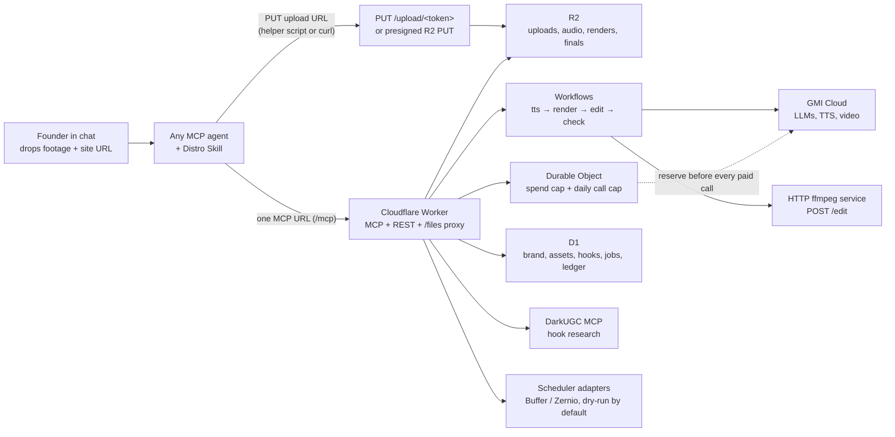

# Distro

**Replace your entire GTM team with one URL.**

Hosted demo MCP URL: <TBD>

## 1. What Distro is

Every founder can now build a product in a weekend. Nobody can afford a
go-to-market expert. Distro turns a founder, or a $15-an-hour hire, into one.
(It is built for the Y Combinator request for startups "The $15-an-Hour
Expert.")

Distro is a self-hostable **agent plugin** in two parts that ship together:

1. **An Agent Skill** (`skills/distro/`) that teaches your agent the
   distribution loop: research what is going viral, write and rank hooks, make
   the video, check it, and hand it to a scheduler.
2. **A remote MCP server** on Cloudflare Workers. You add one URL ending in
   `/mcp` to the agent you already use. Vendor keys, uploaded footage, results,
   and a hard spend cap stay on the server.

You talk to your agent like a founder: drop raw footage into the chat, paste
your site, and say "find what's going viral and make me videos." Distro
returns a ready-to-post 9:16 video with captions, voice, a burned-in
"AI-generated" label, a quality checklist, and the real cost.

Distro is not a SaaS product with sign-up or accounts, and it is not tied to
any particular app. It is a single-tenant service you clone and deploy. You
bring the brand.

## 2. Architecture



| Piece | Role |
| --- | --- |
| Skill | The playbook the agent loads: what to ask, how to upload dropped files, tool order, cost talk, polling. |
| Worker | MCP tools at `/mcp`, `/health`, `/api/*`, `PUT /upload/<token>`, and the `/files/*` media proxy. |
| Workflows | The durable render pipeline. It sleeps between status checks instead of holding a request open for a five-minute render. |
| Durable Object | One global instance that owns the spend cap and the daily research-call counter, so parallel jobs cannot overspend. |
| D1 | Brand profile, assets, hooks, ranks, jobs, sanity results, spend ledger copy, publish drafts. |
| R2 | Private bucket for uploads and outputs. Media is read through `GET /files/<key>`. |
| ffmpeg service | A small HTTP service (`scripts/ffmpeg-service.mjs`) that crops, concatenates, captions, mixes audio, and adds the AI label. |

### MCP tools

`set_brand`, `get_brand`, `create_upload`, `analyze_footage`, `research_hooks`,
`rank_hooks`, `make_video`, `get_job`, `sanity_check`, `publish`, `get_spend`.

## 3. Prerequisites

- Node.js 20 or newer and npm.
- A Cloudflare account on the **Workers Paid** plan ($5/month). Durable
  Objects and usable Workflow CPU time need it; the free plan cannot run this
  pipeline.
- A [GMI Cloud](https://www.gmicloud.ai) API key (LLMs, text-to-speech, video
  generation).
- A machine with `ffmpeg` and `ffprobe` to run the edit service, and a
  **public HTTPS URL** that reaches it. A deployed Worker cannot call
  `localhost`. A `cloudflared` quick tunnel is the usual choice.
- Recommended: R2 S3 API tokens, so large files (above roughly 80 MB) can be
  uploaded with a presigned URL.
- Optional: a DarkUGC account for live hook research. DarkUGC exposes a remote
  MCP server with OAuth sign-in at `https://darkugc.com/mcp`; there is no API
  key. Without it, research falls back to the generic seed patterns in
  `fixtures/hook-patterns-seed.json` (see section 11).
- Optional: a Buffer or Zernio key if you want live scheduling.

## 4. Setup

```bash
git clone <this repo> distro
cd distro
cp .env.example .dev.vars   # fill in values; never commit this file
npm install
npx wrangler login
```

`.env.example` lists every secret and tunable by name.

## 5. Provision

Create the Cloudflare resources and copy the printed D1 `database_id` into
`wrangler.jsonc`:

```bash
npx wrangler d1 create distro
npx wrangler r2 bucket create distro
npx wrangler d1 migrations apply distro --remote
```

The Durable Object and the Workflow are declared in `wrangler.jsonc` and are
created on the first deploy.

Set the secrets:

```bash
npx wrangler secret put GMI_API_KEY
```

Start the ffmpeg edit service on a machine that has ffmpeg, expose it, and
give the Worker its public URL:

```bash
node scripts/ffmpeg-service.mjs --port 8788
cloudflared tunnel --url http://127.0.0.1:8788    # prints an https://….trycloudflare.com URL
npx wrangler secret put FFMPEG_SERVICE_URL        # paste the public HTTPS origin
npx wrangler secret put FFMPEG_SERVICE_TOKEN      # strongly recommended; set the same value for the service
```

The service downloads the URLs it is given, so do not expose it openly. Start
it with the same token and limit it to your Worker's origin:

```bash
FFMPEG_SERVICE_TOKEN=<token> FFMPEG_ALLOWED_ORIGINS=https://<worker>.workers.dev \
  node scripts/ffmpeg-service.mjs --port 8788
```

It refuses private, loopback and link-local addresses unless started with
`--allow-private`, which is for local development only.

A quick tunnel URL changes every time `cloudflared` restarts. Update
`FFMPEG_SERVICE_URL` when it does, or use a named tunnel or a small VM for a
stable address.

Optional secrets:

```bash
# Large uploads through presigned R2 URLs
npx wrangler secret put CLOUDFLARE_ACCOUNT_ID
npx wrangler secret put R2_ACCESS_KEY_ID
npx wrangler secret put R2_SECRET_ACCESS_KEY

# Live hook research. First run the one-time sign-in, which opens a browser and
# writes the four values to .dev.vars:  node scripts/darkugc-oauth.ts
# The access token lasts about an hour; the Worker refreshes it with the
# refresh token, so all four are needed.
npx wrangler secret put DARKUGC_ACCESS_TOKEN
npx wrangler secret put DARKUGC_REFRESH_TOKEN
npx wrangler secret put DARKUGC_TOKEN_ENDPOINT
npx wrangler secret put DARKUGC_CLIENT_ID

# Signed /files URLs, schedulers
npx wrangler secret put FILES_SIGNING_SECRET
npx wrangler secret put BUFFER_ACCESS_TOKEN
npx wrangler secret put ZERNIO_API_KEY
```

## 6. Deploy

```bash
npx wrangler deploy
```

Wrangler prints the Worker origin, for example
`https://distro.<account>.workers.dev`. Your MCP URL is that origin plus
`/mcp`.

| Route | Purpose |
| --- | --- |
| `/mcp` | MCP over Streamable HTTP. This is the URL you give your agent. |
| `/health` | Liveness check. |
| `PUT /upload/<token>` | Receives a file for an upload slot minted by `create_upload`. |
| `GET /files/<key>` | Streams a stored object (previews, and media the video model fetches). |
| `/api/*` | Small JSON API used by the bulk upload script. |

Check it:

```bash
curl https://<worker>.workers.dev/health
```

## 7. Install the plugin

You need two things in your agent: the MCP URL and the skill folder
(`skills/distro/`). Client syntax below is marked **unverified** where it has
not been tested against the current release of that client; check the client's
own help if a command is rejected.

**Hosted agents connect from the provider's servers**, so the MCP URL must be
public. `localhost`, stdio servers, and VPN-only hosts will not work for them.

### Claude Code

```bash
claude mcp add --transport http distro https://<worker>.workers.dev/mcp
```

Or add a project `.mcp.json` (this repo ships an example; include
`"type": "http"`):

```json
{
  "mcpServers": {
    "distro": { "type": "http", "url": "https://<worker>.workers.dev/mcp" }
  }
}
```

Install the skill by copying it into your project or user skills folder:

```bash
mkdir -p .claude/skills && cp -r skills/distro .claude/skills/distro
```

This repo is also laid out as a Claude Code plugin
(`.claude-plugin/plugin.json`, `skills/`, `.mcp.json`) and as a single-plugin
marketplace (`.claude-plugin/marketplace.json`). Installing it as a plugin is
**unverified**; if you do, replace the placeholder URL in `.mcp.json` with
your own first.

### Codex (unverified)

```bash
codex mcp add distro --url https://<worker>.workers.dev/mcp
```

or in `~/.codex/config.toml`:

```toml
[mcp_servers.distro]
url = "https://<worker>.workers.dev/mcp"
```

Copy the skill to `.agents/skills/distro` in your project (or
`~/.agents/skills/distro`). `AGENTS.md` in this repo points agents at the
skill and the MCP server.

### Grok Bot (unverified)

Ask in chat: `Add this MCP server: https://<worker>.workers.dev/mcp`. Then
install the skill, or paste the contents of `skills/distro/SKILL.md` into the
chat. Grok Bot cannot reach `localhost`; use the deployed URL.

### Claude (web and desktop)

Customize → Connectors → Add → Custom → Web, paste the MCP URL, and choose "No
sign in." Upload `skills/distro/` as a skill if your plan supports it.
(Unverified menu wording.)

### Cursor (unverified)

`.cursor/mcp.json` or `~/.cursor/mcp.json`:

```json
{ "mcpServers": { "distro": { "url": "https://<worker>.workers.dev/mcp" } } }
```

### ChatGPT (unverified)

Add a custom MCP connector with "No authentication." ChatGPT will not reliably
send a custom bearer header, so leave `DISTRO_BEARER_TOKEN` unset if you want
ChatGPT to connect (see section 10).

## 8. How footage gets in

You drop files into the agent chat. That is the whole user experience.

MCP tools cannot receive chat attachments; the files are sitting on the
agent's machine. The skill tells the agent to:

1. Call `create_upload` with the filename, size, and content type. The tool
   returns a short-lived, single-use `upload_url`.
2. PUT the file to that URL with the bundled helper or curl:

   ```bash
   python3 skills/distro/scripts/upload_footage.py \
     --file ./clip.mp4 --url "<upload_url>" --content-type video/mp4 --asset-id <asset_id>
   # or
   curl -X PUT -H "Content-Type: video/mp4" --data-binary @./clip.mp4 "<upload_url>"
   ```

3. Call `analyze_footage` with the asset ids. The server probes each file and
   returns dimensions, duration, and warnings (not 9:16, silent, possibly
   private).

Upload modes:

- **Worker route** (`PUT /upload/<token>`): works with no extra keys. The
  advertised limit is 80 MB per file.
- **Presigned R2 PUT**: used automatically when the R2 S3 API tokens are set.
  The limit is 512 MB per file.

Accepted types: mp4, mov, webm, m4v, jpg, jpeg, png, webp. Six to ten short
clips, 9:16 or close, work well. Taller phone screen recordings are cropped.

`skills/distro/scripts/prep_footage.py --files …` is an optional helper that
prints size, type, hash, and ffprobe facts as JSON before upload.

If you already have a folder of footage, a bulk script is included for
self-hosters (needs `curl` and `jq`):

```bash
DISTRO_URL=https://<worker>.workers.dev scripts/upload-assets.sh ./footage
```

Never commit footage or rendered videos to the repo.

## 9. Local development

```bash
npx wrangler d1 migrations apply distro --local
npx wrangler dev
```

The MCP endpoint is `http://localhost:8787/mcp`. Local dev reads `.dev.vars`.
In local dev the Worker can reach an ffmpeg service on `localhost`: put
`FFMPEG_SERVICE_URL=http://127.0.0.1:8788` and `ALLOW_LOCAL_FFMPEG=1` in
`.dev.vars`, and start the service with `--allow-private` so it may download
from the local Worker. A deployed Worker cannot reach `localhost`, and
`ALLOW_LOCAL_FFMPEG` must never be set in production. You can
inspect the server with `npx @modelcontextprotocol/inspector`.

## 10. Optional bearer token

Distro has no sign-in. By default every route is open, which is what hosted
agents expect.

If you set `DISTRO_BEARER_TOKEN`, the MCP, API, upload, and `/files` routes
require `Authorization: Bearer <token>` (header only, never a query string).
Use this for a private self-host. Leave it unset for a shared or hosted demo:
ChatGPT's "No authentication" connector does not reliably send a custom bearer
and will fail to connect.

An open deployment means anyone with the URL can call the tools. The spend cap
limits the financial exposure. If `FILES_SIGNING_SECRET` is unset, `/files`
URLs are also readable by anyone who knows the object key; set the secret to
require short-lived signed URLs.

## 11. Guardrails

- **Spend cap.** `SPEND_CAP_USD` defaults to `9`. Every paid call reserves an
  estimate on the global Durable Object before it runs, and is refused if the
  reservation would exceed the cap. Failed generations release their
  reservation. The cap is enforced in Distro's own code and does not depend on
  the provider's balance. `MAX_RENDER_USD` (default `1`) limits a single
  render, and `make_video` asks for `confirm_usd` when an estimate reaches
  `CONFIRM_USD_THRESHOLD` (default `0.50`). `get_spend` reports the numbers.
- **Research cap.** `DARKUGC_DAILY_CALL_CAP` defaults to `30` calls per day.
  Distro stores only derived patterns and the original lines it writes for
  your brand, never raw source content.
- **Seed-pattern fallback.** Live research requires a one-time DarkUGC OAuth
  sign-in so the Worker can act as an MCP client of `https://darkugc.com/mcp`,
  with the resulting tokens stored as Wrangler secrets. When those tokens are
  missing or expired, `research_hooks` uses the generic pattern types in
  `fixtures/hook-patterns-seed.json`, writes fresh lines from your brand
  profile, and says so in its `notes` field. The seed patterns are a fallback,
  not live trend data.
- **Live posting is opt-in on the server.** Even with `dry_run: false`, `publish`
  refuses to post unless `ALLOW_LIVE_PUBLISH=1` is set. The MCP URL is open by
  default, so leave this off unless you also set `DISTRO_BEARER_TOKEN`.
- **Dry-run publishing.** `publish` defaults to `dry_run: true`: it stores a
  draft and returns the payload that would have been sent, without calling any
  third party. Live posting is opt-in per call.
- **Organic TikTok goes through Buffer or Zernio.** The `tiktok` adapter is a
  stub, because the TikTok for Business API is an ads API and not organic
  posting.
- **AI label.** Generated videos have an "AI-generated" label burned into the
  picture. When you post, also keep the platform's AI-content disclosure
  switched on.
- **Sanity check.** Every video is checked for aspect ratio, length, captions,
  audible audio, hook match, brand safety, private content, and the AI label
  before it can be published. Videos that fail are fixed or discarded.

## 12. License

MIT. See [LICENSE](LICENSE).
